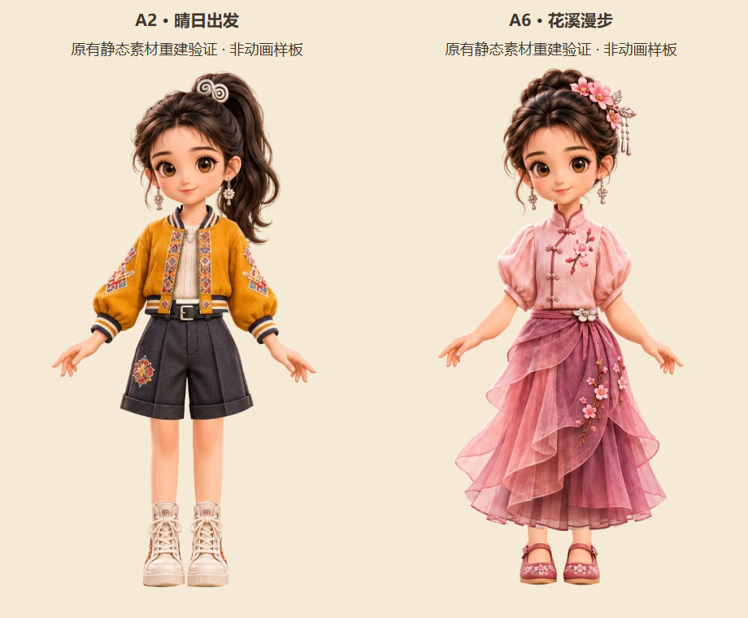
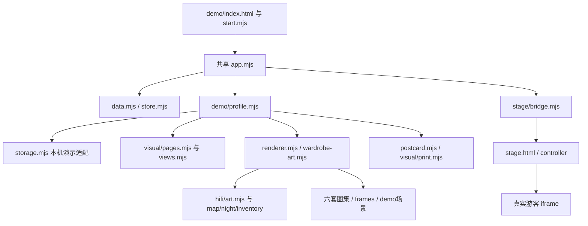

# R00 素材与工程基线盘点

2026-11-08，检查基线 `8c5ba355b4b60708ea8210c238ebfd563b896bde`。结论：现有静态演示可以保留并重建；连续动画所需的可编辑母版、绑定／变形数据及制作人员尚未落实。当前结果支持进入方案和样板准备，不支持直接批量生产动画衣橱。

机器盘点见[baseline-inventory.json](../output/r00/2026-11-08/baseline-inventory.json)：69 个相关图片的路径、尺寸、字节数与哈希，26 个当前模块的字面 import 依赖；未发现缺失的字面模块引用。动态拼接资源另按源码核对，不能把此表称作完整生产打包清单。

## 素材现状与来源

| 输入 | 已有文件／实际使用 | 来源与确认状态 | 生产能力及缺口 |
| --- | --- | --- | --- |
| 固定身份参考 | [companion.png](../design/hifi/assets/companion.png)、[生成说明](../design/hifi/assets/prompts.md) | 基于原画板参考生成的概念形象；服装六稿共用此身份参考 | 有透明整图，无脸部多角度／独立五官变形母版；不是生产身份规范 |
| 身体与固定脸部 | [wardrobe-art.mjs](../design/demo/wardrobe-art.mjs)；`start-b` 图集的 `base`、`start-a` 的 `face/joy` | 从六套确认图拆取，运行时共享脸部 | 固定舞台拼装；身体受原图姿势限制，没有完整遮挡后躯干／关节／闭眼过程源件 |
| 六套款式及 24 部件 | [确认与映射](../reviews/2026-11-05-wardrobe/selected/README.md)、[selection.json](../reviews/2026-11-05-wardrobe/selected/selection.json) | A1/A2/C3/A4/B5/A6 均已确认；保存原稿、参考格、提示及稳定 ID | 可继续作款式基线，PNG 是扁平画稿；需统一母版并补动画分层、衣物内侧及遮挡区 |
| 静态可穿戴图集 | [frames.mjs](../design/demo/assets/wardrobe/frames.mjs)、同目录六张图集／24 张缩略／头像 | 由确认稿裁切、抠边、手动锚点装配；不覆盖原稿 | 有静态重建方法；矩形帧坐标不是骨骼绑定。渲染坐标 660×1020，输出角色 440×680；这些是现状，不冻结为生产分辨率 |
| 表情与姿势 | `calm/joy`、`stand/wave`；`extract.mjs`、`portrait-matte.mjs` | 当前静态表情和挥手变体，后两项为两个池共有资产 | 不是连续眨眼／手臂运动；需验证基础 `idle/blink/tapResponse` 与奖励表情／姿势的优先级和兼容，不能新增经济规则 |
| 图层修整和构建 | [build 入口](../reviews/2026-11-05-wardrobe/selected/build/build.mjs)、同目录 fittings／silhouettes／extract／portrait-matte | 可读源码、手工切片和锚点，重建路径可追溯 | 可复现静态几何；编码工具链未冻结，见下方像素差异。动画生产编辑文件仍缺 |
| 伙伴、地图、展示图标 | `design/hifi/assets/night.png/map.png/inventory.png`、`design/hifi/art.mjs` | 概念场景与代码图标；[来源提示](../design/hifi/assets/prompts.md) | 是真实运行依赖，但不是核实的现场照片／地理地图。场景试点时换真实内容依据 |
| 黔山同行八场景 | [四景原画](../reviews/2026-11-05-ui-companion/四景原画.png)、[旅途道具原画](../reviews/2026-11-05-ui-companion/旅途道具原画.png)、[来源文字](../reviews/2026-11-05-ui-companion/美术来源与提示词.txt)、运行 `design/demo/assets/scenes/` | 用户认可整套风格；从两原画拆得八张 508×764 图，评审副本和运行副本均保留 | 可复用气氛／页面背景；不是角色可动源件，不因哈希重复删除语义不同副本 |
| 两种图片模板 | [postcard.mjs](../design/demo/postcard.mjs)、[print.mjs](../design/demo/visual/print.mjs) | 当前 Canvas 合成，保留 `postcard/trail` ID | 可作为构图与行为参考；未来动画渲染器需明确导出帧、资源版本、字体与跨域策略 |
| 字体 | [theme.css](../design/demo/visual/theme.css) 的 `--hand/--body`，其余 Canvas 字体声明 | 使用 KaiTi／系统宋体／微软雅黑／PingFang 等回退；未发现仓库打包字体 | 手机不保证呈现 Windows 楷体；需跨环境检查换行、字体回退与 PNG。若新增嵌入字体另核来源／使用范围，不复制本机系统字体发布 |

授权口径：来源文件和用户款式确认可追溯，不等于正式角色、参考图、生成平台、字体和后续外包交付的生产使用范围全部核实。仓库未找到统一生产授权清单；用户协调素材权属材料，Codex 登记适用范围，制作方交可编辑源件和交付权利说明。最迟在选定制作方案／工具前处理影响该选择的授权，在投放 G4 前补齐实际首批素材的使用范围。

搜索范围是 Git 跟踪文件中的 PSD/PSB/ORA/KRA/XCF、Blend/FBX/GLB/GLTF、Live2D/Spine 等常见源格式和内嵌字体。没有找到这些可编辑源件；未扫描外部盘、未交付的美术文件或压缩包内部，因此不声称外部不存在。已提交 ZIP 是逐屏视觉评审交付，不能据文件名当动画源件。

## 静态重建实证与候选样板

在独立目录调用原 `buildSet` 重建 A2（`start-b`）与 A6（`flower`），没有运行会覆盖成品的原 `build.mjs`，没有改动运行图集。两套共 10 个图集／缩略文件，帧坐标及所有 alpha 像素一致；其中 3 个文件 RGBA 完全一致，7 个 RGB 有微小差别。单通道平均绝对差最高约 0.140/255、单像素最大差 9/255。差异出现于本机重新输出结果，具体来源未定，不声称字节或像素完全复现。

本次直接查看[重建展示](../output/r00/2026-11-08/static-rebuild-preview.png)，脸部、衣领、上下装、脚口及完整构图可辨，款式未改变；这只是静态可用性检查，不代表动态姿势无穿帮。原始指标和 Chrome 版本见[重建记录](../output/r00/2026-11-08/rebuild-check.json)。正式生产应冻结工具链，并以几何、透明边和渲染效果回归，不直接覆盖旧图宣称相同版本。

建议 R02 用 A2＋A6 作为**待确认的技术样板组合**，不是新增选款决定：

| 样板 | 主要差异 | 必须揭示的技术问题 |
| --- | --- | --- |
| A2 晴日出发 | 高马尾、夹克、短裤、露腿、高帮鞋 | 发尾前后层；袖口／手臂连续回应；裤腿／皮肤／鞋口接缝 |
| A6 花溪漫步 | 盘发、短泡袖、分层长裙、绣花鞋 | 头饰摆动、肩袖遮挡、裙腰与裙摆、长裙运动及脚部露出 |
| 两套交叉混搭 | A2 上衣＋A6 裙，A6 上衣＋A2 短裤，各换发型／鞋 | 固定脸部与身材，衣长与腰线兼容；不以整张人物替换冒充换装 |

需先交：同一母版的身体与五官分层、衣物内外层和遮挡补画、发饰／发丝前后层、合法组合表、连续动作规则、确定静态导出姿势、源件及导出清单。先修正母版和局部遮挡，再绑定／变形和动作，最后测动态换装与图片。具体二维分层／其他路线及制作工具在 D03 比较，不在 R00 强行决定。需要的美术修整、绑定和连续动作制作能力尚未落实，由用户协调资源、Codex 提供规格和技术验证，详见[责任台账](R00内测范围与决策台账.md#责任资源缺口及继续条件)。

## 工程基线与真实依赖

本次从计划提交 `8c5ba35` 建立 `codex/internal-alpha-r00-20261108`，作为后续接续基线。远端 main `4d2c933`、原演示分支及标签 `68d9f33` 保留；最新分支入口只看 [HANDOFF](../HANDOFF.md)。不把固定标签随开发移动。

| 当前边界 | 实际入口与影响 | 后续拆分方式／保护对象 |
| --- | --- | --- |
| 控制器与守卫 | `design/app.mjs` 仍共享路由、事件、草稿和事务调用，按 demo profile 切表现 | 逐用例提取，避免只替换存储就误称真实账号；老原型与演示均回归 |
| 规则／数据 | `store.mjs/data.mjs` 本地业务与固定配置 | 纯规则可复用；服务端事务／授权重建适配，不把本地结构整体上传覆盖云库 |
| 演示持久化 | `demo/storage.mjs` 注入存储、session 前缀及 epoch | 保留 `hxx.demo.v1`／原型 `hxx.interactive.v2`；不改键当升级，不自动迁移 |
| 角色与图片 | `renderer/wardrobe-art/postcard/visual/print` | 渲染端口独立，静态图集保留演示；正式 look、资产 ID 与图片快照保持稳定边界 |
| UI 与样式 | `demo/visual/*`、共享 `game-ui.mjs`、demo 样式层 | 分页作用域；只替换依赖的服务或渲染能力，不同时重做已认可场景 |
| 高保真依赖 | renderer 读取 hifi 的 art、map/night/inventory；样式引用 night/map；另读 demo 手账图 | 不能删除整个 hifi。未来发布按实际请求和 import 闭包列资源，再搬迁／抽取，并保持旧入口可读 |
| 演示控制台 | `stage/controller/bridge/preparation`；播放依赖 `output/stage-rehearsal/三栏连续彩排.webm` | 仅旧演示保留；正式发布排除侧栏、备份载入、复位和模拟成功工具，不能靠隐藏按钮隔离 |

字面 imports 全部存在不证明动态图片引用齐全。本次还实际跑旧演示主线和 PNG，检查加载错误；未来正式包需做 OP01 真实部署访问验证，R00 仅完成隔离设计。

## 目标入口、环境与数据隔离设计

以下为 R03-01 的实施约束，不表示新目录、域名或服务已经建立。最终工程目录在 R01 选择技术后落位，先定义稳定边界，避免现在机械搬目录。

| 维度 | 既有演示 | 真实账号内测 | 未来生产／景区试点 |
| --- | --- | --- | --- |
| 入口 | `/design/demo/index.html` 与 `stage.html` | 独立 HTTPS 入口／源，与演示分部署；从产品首页或有效扫码深链进入 | 单独生产环境、域名与发布配置，D02 决定具体值 |
| 身份 | 浏览器 A/B 手账 | 真实认证主体映射 server accountId；受邀访问 | 真实游客／店员／运营权限；预留黄晓西可信映射 |
| 数据 | 本地两个既有键，不触碰用户存档 | 独立测试库、对象空间、密钥和业务流水；不可与演示 localStorage 混用 | 独立生产库／文件／凭证，不把内测余额迁入真钱经济 |
| 本地缓存／草稿 | 当前 session 与 epoch | 按 environment＋accountId＋schemaVersion 分区；不充当权威余额。具体保留及迁移等 D07 | 同样隔离身份和环境；不能从浏览器参数决定写入者 |
| 核验／订单 | 本地明确模拟 | 服务器受控测试凭证与模拟订单，权限／限流／审计；不能传 success=true 即发奖 | 不部署测试结算接口；真实核验／支付需各自可信凭证 |
| 配置／资产 | 固定测试配置和已交静态成品 | 配置与素材版本、测试标识及两阶段资产样板；读写独立 | 实际点位与授权素材；历史 work 的固定图不重绘 |
| 诊断／复位 | 明确确认的演示工具 | 操作者受限的测试夹具与只读诊断；游客无任意发奖、改余额／复位权限 | 禁止携带演示工具和测试凭证，操作记录可审计 |
| 回退 | Git 固定演示＋本人手动备份 | 代码／配置／资产／数据分别有版本及恢复路径 | 云数据恢复须核对回退后新增写入与文件，不能覆盖丢失 |

“内测业务是真实服务”与“点位和购买是测试情境”同时成立：云端归属、幂等和并发必须真实；界面、来源记录、订单与流水必须说明测试／模拟。生产隔离需以服务端拒绝与发布资源检查证实，不能靠 URL 名字或前端开关保证。

## 当前验证与尚未验证

- 本次核对实际 Git refs、素材尺寸／哈希、导入关系及配置；六套对应 24 服饰资产，另 7 表情／姿势／背景，共 31 个业务资产。
- 独立浏览器上下文复演现有主线：初始化→领装→测试到访→抽取→换装→实际 PNG；测试覆盖六种窗口和演示侧栏／恢复边界。用户浏览器和已有手账未触碰。
- 这只能证明原基线仍可运行。没有真实账号、云服务、连续动画或手机／微信真机结果；它们分别在 G1—G5 验收，不能由本次静态和桌面测试替代。

命令、结果、限制与各任务状态统一记在[G0 记录](R00阶段验收记录.md)。
