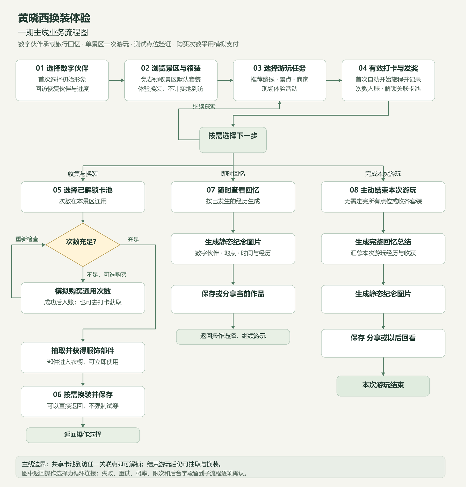
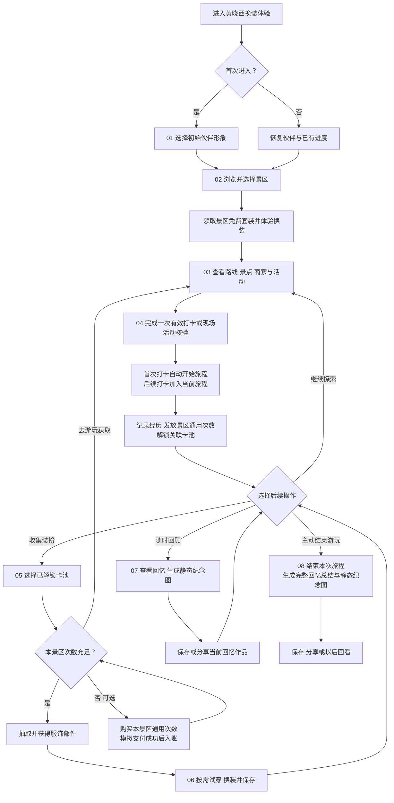

# 黄晓西换装体验一期主线业务流程图

版本：主线确认版 v1。确认日期：2026年10月19日。

一期主线为：选择黄晓西数字伙伴，在线领取景区套装体验换装，到访景点或参与现场活动获得景区通用次数并解锁卡池，按需抽取部件与换装，随时生成回忆，并在主动结束游玩后形成完整总结。以可部署测试体验版验证流程，购买次数采用模拟支付。

图中“有效核验”“抽取”“保存／分享”作为整体业务节点，具体失败、重试、限次与交互规则留到对应子流程。各分支都是游客可选择的行为，生成回忆或结束游玩无需先完成全部点位、抽取或换装。

## 可编辑流程图

## 主线确认事项

| 讨论卡片 | 确认结果 |
| --- | --- |
| 卡池解锁 | 首次有效到访关联景点解锁，之后可随时抽；共享卡池到访任一关联景点即可解锁。购买次数不绕过解锁条件。 |
| 旅程范围 | 一期以单个景区的一次游玩组织。 |
| 回忆时机 | 游玩中可随时生成作品，主动结束后形成完整总结。 |
| 旅程开始 | 首次有效打卡自动开始；线上领套装不算实地到访。 |
| 最终交付 | 回忆记录和静态纪念图片，可保存或分享；视频和实体订单后续再做。 |

套装归属景区，运营将套装组合为卡池并关联点位；点位可以共享卡池。打卡与购买的次数均进入本景区通用余额，游客可以跨点位积累和使用。结束一次游玩不撤销已解锁卡池；之后仍可抽取和换装，历史回忆的修改方式在子流程确认。

静态图以新游客首次游玩为主路径。回访游客恢复进度；已有卡池与资产可直接进入抽取或衣橱，无需再次完成首次领取或打卡。图中换装节点包含“暂不试穿直接返回”，不会强制立即使用新部件。

## 下一步按阶段细化

| 阶段 | 下一轮需要讨论的子环节 |
| --- | --- |
| 01 伙伴选择 | 初始模板、身份固定范围、确认和回访恢复。 |
| 02 景区与免费套装 | 领取时机、是否每景区一次、试穿与保存、线上预览边界。 |
| 03 路线与任务 | 路线入口、景点商家活动关系、奖励预告与前往方式。 |
| 04 核验与发奖 | 扫码／定位／活动凭证、重复参与、任务周期、卡池解锁、异常处理。 |
| 05 抽取与购买 | 余额、单抽／连抽、不重复规则、抽空、套餐及模拟订单。 |
| 06 衣橱与换装 | 部位、互斥、预览、保存、穿搭快照与素材要求。 |
| 07 即时回忆 | 记忆内容、图稿模板、形象选择、保存分享。 |
| 08 结束与总结 | 结束确认、完整总结、回看、再次到访与新旅程。 |

每个阶段同时确认游客操作、系统处理和后台维护动作。全部子流程收敛后，再划分模块与页面并进入开发。
