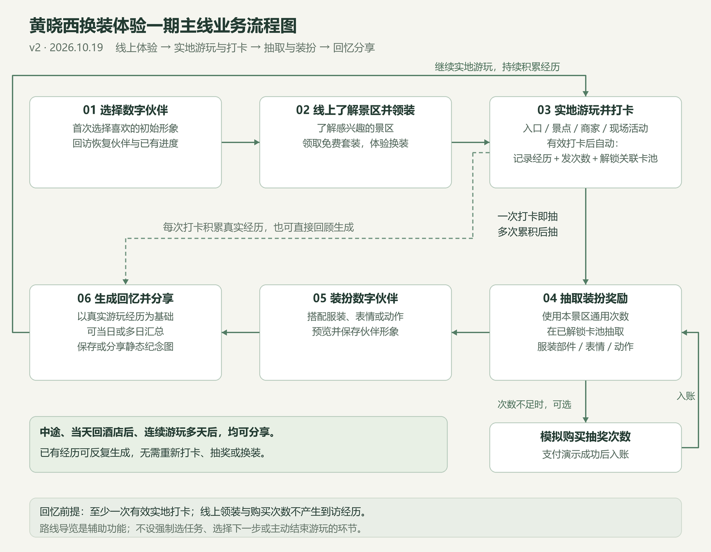
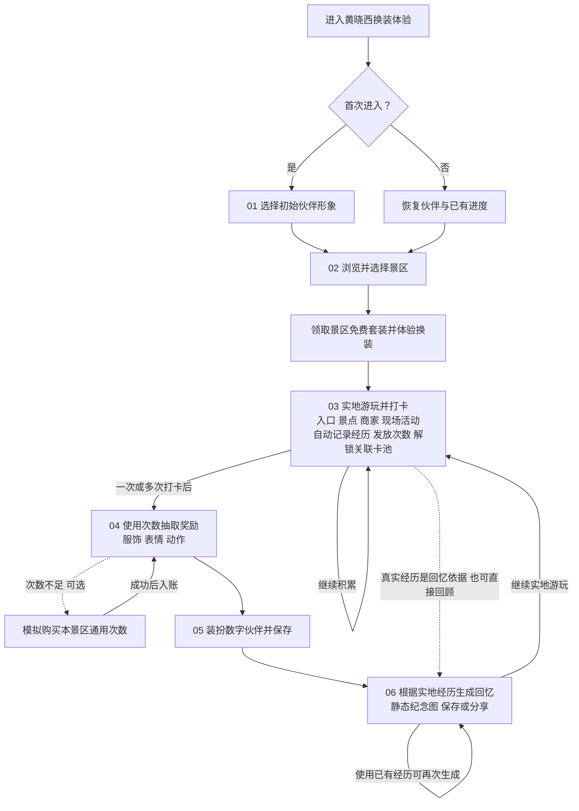
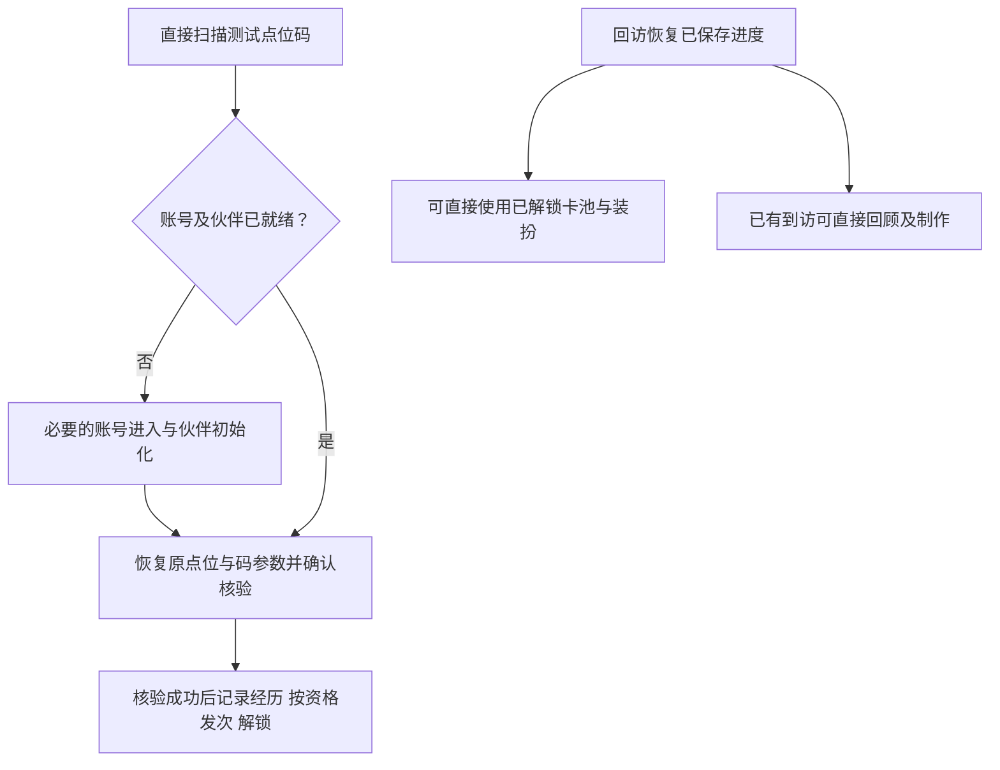

# 黄晓西换装体验一期主线业务流程图

版本：主线修订版 v2。更新日期：2026年10月19日。

一期主线为：选择黄晓西数字伙伴 → 线上了解景区并领取免费套装 → 到实地游玩并打卡 → 获得景区通用次数并解锁关联卡池 → 抽取服饰、表情或动作并装扮伙伴 → 根据真实游玩经历生成回忆和静态纪念图，保存或分享。以可部署测试体验版验证流程，购买次数采用模拟支付。

实地游玩与打卡作为同一业务阶段：游客到达景区入口、景点、商家或参加现场活动后，完成有效核验。系统记录经历、发放次数及解锁对应卡池，均为这次打卡的结果，不再拆成重复的用户步骤。

可以一次打卡后立即抽，也可以多次打卡积攒后再抽。回忆至少需要一次有效实地打卡，线上浏览和领装不能生成真实到访记录；抽取与装扮丰富纪念画面，不是到访经历的来源。

路线导览与推荐是辅助功能，不是必经的选择步骤。分享可发生在游玩中、回酒店后或连续游玩多天之后，不设“开始旅程”“结束旅程”操作，也不以离开页面或当天结束作为回忆封存条件。

## 可编辑流程图

## 主线确认事项

| 讨论卡片 | 确认结果 |
| --- | --- |
| 卡池解锁 | 首次有效到访关联景点解锁，之后可随时抽；共享卡池到访任一关联景点即可解锁。购买次数不绕过解锁条件。 |
| 回忆范围 | 一期按景区保存实际游玩经历，可累计跨日记录，用于单次、当天或多日分享；具体筛选方式留到子流程。 |
| 回忆时机 | 实地打卡之后，中途、当天回酒店后或连续游玩多天后，都可以生成和分享。 |
| 到访依据 | 每次有效实地打卡自动记录地点、时间与经历；线上领套装不算到访。 |
| 游玩起止 | 不需要游客主动开始或结束；不设置“结束后才能生成完整总结”的条件。 |
| 导览地位 | 路线、点位推荐和商家分流服务实地游玩，不增加强制选路线或选任务步骤。 |
| 奖励类型 | 抽取服装部件、表情或动作，用于数字伙伴装扮与纪念作品。 |
| 最终交付 | 回忆记录和静态纪念图片，可保存或分享；视频和实体订单后续再做。 |

套装归属景区，运营将套装组合为卡池并关联点位；点位可以共享卡池。打卡与购买的次数均进入本景区通用余额，游客可以跨点位积累和使用。关联点位可包含景区入口，解锁哪些卡池按运营配置，不能把入口打卡默认解释成全部卡池解锁。之后离开现场仍可使用已解锁卡池、装扮和生成回忆。

静态图以新游客从线上体验到实地游玩再分享为主路径。回访游客恢复已有进度，无需再次领取或到现场才能使用已解锁资产。抽奖、装扮与回忆可在不同时间完成；不要求每打一次卡就必须抽一次，也不要求每次生成前必须重新抽取或换装。

## 直接入口与回访支线

上方 PNG／SVG 与 Mermaid 保留 v2 主路径，不枚举所有进入方式。当前交互补充如下，线上领装不成为打卡前置条件：

各阶段核心选择已通过 13 张卡片确认，见[确认记录](子环节确认清单.md)。当前页面、返回和异常以[交互规格](完整体验与验收标准.md)为准，后续任务见[实施计划](开发实施任务与里程碑.md)；不再把已答问题列为下一轮待答项。

v2 按用户本轮纠正，撤回 v1 中“选择游玩任务”的必经阶段及“主动结束游玩”分支。旧稿仅保存在 history 中作为修订记录，不作为当前产品规则。
