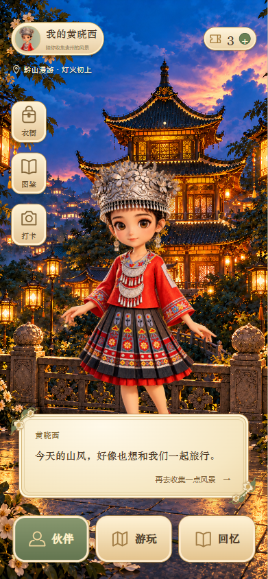
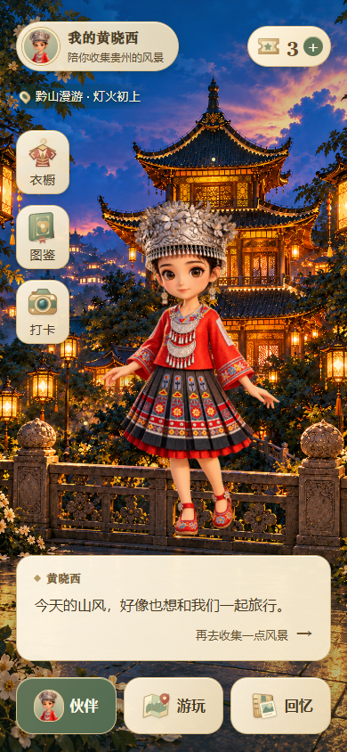

# 伙伴首页 UI 修订与验收

日期：2026-10-20，北京时间。范围：高保真稿的伙伴首页，包含默认及尚未到访两种状态。业务原型仍为 v0.3.1，其他高保真页面保持原设计。本次实现完成，最终视觉待用户评审。

## 批准范围与逐项交付

用户批准前一轮视觉方案，要求逐项修改和验收：保持夜景、奶油金与青绿色、人物素材及现有功能结构，调整图标、整体平衡、阅读、按钮比例与内距。

| 方案项 | 本次完成 | 验收方式 |
| --- | --- | --- |
| 图标材质 | 首页绘制衣饰、收藏册、相机、地图、旅行手账和票券六种填色道具图标，加入明暗与少量高光；伙伴入口使用现有人物头像徽章，定位使用填色标记 | 在 360／390／430px 截图中检查识别性；首页未继续使用通用空心线框图标 |
| 整体轻重 | 统一暖纸、青绿和暖金材质，移除首页面板多重描边及重复角饰，保留轻边线和柔和投影 | 直接查看完整页面，比较人物、场景、顶部、侧栏、对话与导航的主次 |
| 顶部身份 | 42px 头像、15–16px 名称、12px 副文案；胶囊按内容收紧，减少无效空白 | 检查文字裁切、内距及与右侧次数之间的间隔 |
| 次数入口 | 独立票券插画、22px 数字和 22px 加号，入口高度 46px；保留原次数页跳转 | 默认余额 3、尚未到访余额 0，点击及边界检查通过 |
| 左侧快捷入口 | 常规为 60×72px、40px 图标容器和 14px 文字；小屏为 56×66px、36px 图标容器和 13px 文字 | 衣橱、图鉴、打卡均实际点击；图文保持在按钮内部 |
| 对话面板 | 暖纸色单层面板，正文 16px／1.6 行高，署名与引导 13px；左右内距 20px，独立安排署名、正文和引导 | 默认、未到访及点击人物后的原台词均可读；两行文字不裁切，人物与面板不重叠 |
| 底部主入口 | 常规 64px、小屏 60px 高；16px 文字，统一图文中心和内距；选中态保持青绿 | 伙伴／游玩／回忆入口、选中状态和尺寸检查通过 |
| 字体分工 | 名称与署名保留宋体气质；操作、正文和辅助信息使用黑体体系；首页辅助文字至少 12px | 六尺寸读取实际字体与文本边界；未用整页缩小来满足桌面显示 |
| 桌面阅览 | 首页保持 390×844 的原尺寸，矮窗口可滚动查看 | 1024×768、1280×720、1440×1000 均验证 1:1 宽度及无横向溢出 |

设计依据来自前一轮对[奇迹暖暖实机资料](https://www.qbnews.tw/game-ui-ui_89/)、[无限暖暖界面资料](https://www.qbnews.tw/《無限暖暖》-遊戲ui典藏：介面、選單與畫面截圖/)及[官方界面优化说明](https://infinitynikki.infoldgames.com/en/news/164)的查阅，借鉴道具表达、视觉分组和场景展示。六种首页道具图标为本项目独立绘制的可编辑 SVG，人物及夜景沿用已有素材。

## 前后对照与最终截图

| 修改前（本机原稿） | 修改后（390×844） |
| --- | --- |
|  |  |

- [360×640 默认](../output/playwright/partner-review/360-640-default.png)、[尚未到访](../output/playwright/partner-review/360-640-first-visit.png)
- [390×844 默认](../output/playwright/partner-review/390-844-default.png)、[尚未到访](../output/playwright/partner-review/390-844-first-visit.png)
- [430×932 默认](../output/playwright/partner-review/430-932-default.png)、[尚未到访](../output/playwright/partner-review/430-932-first-visit.png)
- [1024×768 桌面](../output/playwright/partner-review/1024-768-default.png)、[1280×720 桌面](../output/playwright/partner-review/1280-720-default.png)、[1440×1000 桌面](../output/playwright/partner-review/1440-1000-default.png)

已直接查看手机默认、未到访及桌面稿。总览使用的 `output/playwright/hifi/partner.png`、`states/partner-first-visit.png` 和 `overview.png` 已更新。

## 两轮检查与修正

第一轮检查多尺寸布局及入口：收紧顶部过长的身份底板；修正小屏对话框遮住人物下半身的问题；调整人物显示范围、断行和底部间隔；桌面首页取消整页缩小，改为原尺寸滚动阅读。

第二轮独立检查阅读和边界：加大侧栏图标的实际显示面积；加深选中导航底色。随后按浏览器实际样式计算对比度，发现半透明身份底板的副文案保守值为 4.40:1，低于本轮 4.5:1 目标，已加深副文案颜色并重新执行专项验收。[修正前记录](../output/playwright/partner-review/contrast-before.json)保留这一项失败；以下为修正后的结果。

| 验证 | 结果 | 证据 |
| --- | --- | --- |
| 首页专项 | 141 项通过，0 失败，错误列表为空 | [最终 JSON](../output/playwright/partner-review/verification.json) |
| 整套高保真回归 | 216 项通过，0 失败，错误列表为空 | [回归 JSON](../output/playwright/partner-review/regression.json) |
| 正文对比度 | 保守值 8.60:1 | 专项 JSON 中对实际渲染样式的计算 |
| 身份副文案对比度 | 保守值 5.37:1 | 同上 |
| 选中导航文字对比度 | 4.77:1 | 同上 |
| 其他页面外观隔离 | 19 页与接续时截图 SHA256 一致；卡池在独立全新上下文中对比原／新页面源码，截图 SHA256 一致 | [20 页对照](../output/playwright/partner-review/unaffected-pages.json)、[卡池独立复核](../output/playwright/partner-review/pool-comparison.json) |
| 语法与差异 | 新增首页模块、页面入口、交互入口及专项脚本均通过 Node 语法检查；Git diff 无空白错误 | 本机执行 |

透明底板的对比度采用背景全黑的保守下限，读取页面当前计算样式；未声称对照片背景的每个像素或所有浏览器做出无障碍认证。

专项覆盖六尺寸、两状态、图片加载、文字裁切、图文边界、主要按钮至少 44×44、面板间隔、人物避让、示例余额、无业务存储写入、九个原入口、人物原回应、衣橱保存返回、未到访引导及键盘操作。全套回归继续覆盖其余页面和状态、登录与绑定草案、制作返回、模拟订单以及总览图片加载。

所有浏览器检查使用独立上下文，没有重置或写入用户业务原型进度。卡池历史截图曾出现仅人物栅格化不同的结果，因此额外使用原／新页面源码在相同新上下文中复核，确认页面输出一致。

## 文件和复验入口

- `design/hifi/partner-page.mjs`：独立首页构图，保留原 `data-go`／`data-action`。
- `design/hifi/partner-art.mjs`：首页专用 SVG 插画。
- `design/hifi/partner.css`：首页局部样式与桌面原尺寸阅览；其他页面使用原样式。
- `design/hifi/verify-partner.js`：专项脚本，结果变量 `window.hxxPartnerQA`，截图在本记录对应目录。

服务启动、CLI 浏览器准备及复验命令见[高保真 README](../design/hifi/README.md)。线上功能、真实账号、生产换装素材与角色动作系统均不属于本次修改。自动检查与本次看图不能替代用户对视觉平衡和精致程度的判断。

本机未配置 Git 作者身份，提交尝试未成功。本轮修改及此前本机部署文件仍在工作区，未提交或推送，未代填作者身份。
