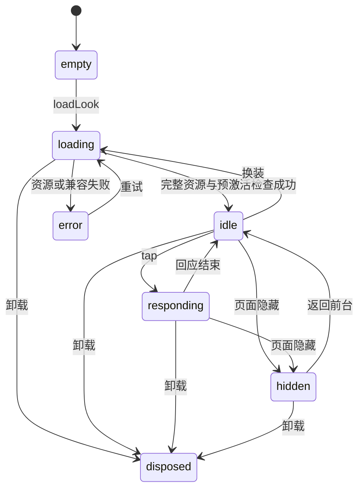

# 动画样板制作与技术评估

日期：2026-11-08；R02 前期工作。用户本轮确认暂无美术人员／合作方，先完成制作规格和技术比较。因此本次不制作新角色、不采购引擎、不把现有静态图集整体摆动当作正式动画样板。下文可直接交给潜在制作方评估；G2 尚未通过。

## 要交付的具体样板

一个固定身份的黄晓西，建议先用 A2 晴日出发和 A6 花溪漫步两套已有确认款做技术验证；实际样板选款／母版仍需在制作开始前确认。最终六套范围不缩减。参考入口：[六套确认稿与 ID](../reviews/2026-11-05-wardrobe/selected/README.md)、[源件盘点](R00素材与工程基线盘点.md)。

样板必须同时展示：待机呼吸与轻微自然运动、连续闭眼／睁眼、点击后的连续回应并回待机、运动中换单件、跨套混搭、确定姿势 PNG。完整播放一段视频或更换整张人物图都不能满足混搭要求。禁止用截图、录屏或 GIF 代替可编辑源件。

## 路线比较及验证顺序

| 路线 | 对此项目的适用性判断 | 必需输入／代价 | 当前证据和下一步 |
| --- | --- | --- | --- |
| 分层骨骼／网格形变，Spine 类 | **优先候选**：全身服装部件、袖口／裙摆、同一动画下多件混搭较贴合主线 | 统一角色分层、完整遮挡补画、骨骼／网格／权重、动作制作；工具及运行授权须核实 | 官方 runtime skins 支持组合多项附件；未用黄晓西源件验证，不能据此宣称已通过 |
| Live2D 参数形变 | **备选**：面部、呼吸和轻度陪伴回应适合；如果制作方更熟悉此工具可优先做同一验证集 | 五官细分、补画、变形器、参数、服装可见性与加载／混搭组织；不能只换整个模型 | 官方 Web SDK 有眨眼／呼吸／动作支持；正式分件换装、体积与成本仍需样板 |
| 自定义 Canvas/WebGL 分层动画 | 代码可控、现有页面接入轻 | 缺少生产编辑器和自动变形工作流，维护绑定／遮挡／眼睑／服饰兼容容易变成自制引擎 | 只保留为受限验证候选；不因没有制作方就默认最省成本 |
| 三维模型＋服装绑定 | 可支持转身等未来能力，但本轮没有这类确认需求 | 同身份建模、拓扑、骨骼、服装蒙皮、材质／光照、碰撞及移动性能 | 现有 PNG 不能直接替代；前期投入最大，暂不作为首选 |

这里的优先顺序是基于本项目“全身服装混搭＋有限陪伴动作”的工程判断，不是已经选定工具。Spine 官方文档说明附件可按部件组合成运行时 skin，[来源](https://esotericsoftware.com/spine-runtime-skins)；Live2D 官方材料说明建模前需拆分睫毛、眼球等并补画运动后露出的区域，[来源](https://docs.live2d.com/en/cubism-editor-manual/divide-the-material/)。这些能力依据不等于两套黄晓西在微信内已可运行。

授权也不能混为“引擎开源免费”：Spine runtime 的集成条件关联其 Editor 许可，[官方条款](https://esotericsoftware.com/spine-runtimes-license)；Live2D 的开发验证与发布许可分开，并有主体／用途条件，[官方说明](https://www.live2d.com/en/sdk/license/)。本项目涉及数字伙伴和可能的企业交付，发布使用范围须按实际主体与用途核实；本轮没有得出免费商用结论或采购价格。

验证顺序：先由能交付源件的制作路线产出同一母版和两套样板，再比较部件替换／回应／导出与四环境量测。若只是官方示例角色能跑，最多证明 SDK 能加载，不能通过 AN01、AN04、AN07。未确定路线前不把 SDK 加入正式游客包。

## 发给制作方的源件交付要求

| 交付组 | 最少内容 | 拒收条件／检查方法 |
| --- | --- | --- |
| 身份母版 | 正面基准站姿、脸部特写、头身比例、肤色、眼睛／眉／口参考；保留目前可识别身份 | 六套脸不同、头身拼接或依赖服装掩盖缺口；与确认参考逐项对照 |
| 身体与遮挡底层 | 完整头、颈、躯干、上／下臂、手、腿和足的可编辑层；衣服移开后仍有合理内容 | 只有穿衣后的合并图片；挥手或换短装后露空洞 |
| 面部 | 固定脸底、独立眼白／眼球／上下眼睑／睫毛／眉／口，以及必要闭眼补画 | 压扁整张脸冒充眨眼；闭眼变化导致人物身份漂移 |
| 发型与银饰 | 前发／后发／发尾、饰品与遮挡层；明确与脸、颈、衣领的先后关系 | 头周米白边、银饰高光被抠掉、长发遮住手臂时顺序错误 |
| A2 上下装 | 夹克躯干、袖部与袖口、内搭；短裤及腿部边缘；高帮鞋完整 | 手臂一动袖口裂开；裤腰／露腿接缝；鞋口压腿 |
| A6 上下装 | 泡袖短衫、领口、裙腰、前后裙片／纱层和裙摆；鞋履 | 裙摆只一张硬纸片、运动露背景空洞、半透明边缘脏色 |
| 绑定与动作 | 可编辑工程、骨骼／参数／网格／权重／遮罩、动画源曲线 | 只交运行文件或视频、无法调整一件衣服、无法重建 |
| 导出与版本 | 原始源件＋运行导出＋manifest＋版本与软件版本／导出参数＋操作说明 | 未锁工具版本、原件被覆盖、缺失素材或 ID 与业务不一致 |
| 使用范围 | 原创／参考来源、生成部分标注、交付主体、可修改／再发布范围 | 将来源未知图片当已授权生产资产；源码交付条件不清 |

画布、贴图尺寸与压缩参数由样板测量冻结。本轮现有 660×1020 拼装坐标和 440×680 输出仅作历史参考，不要求美术迁就旧裁切。基础素材可保持透明，必须同时在浅奶油、深夜景和复杂地图底验证发丝、银饰、颈口、裙摆与鞋底。

### 业务 ID 与制作层映射

| 业务资产 | 建议制作层组（可按引擎细化） | 校验 |
| --- | --- | --- |
| `start-b-hair`／`flower-hair` | hair_back、hair_front、ornament、必要发尾 | 同一 fixed_face 保持，整组单件替换 |
| `start-b-top`／`flower-top` | torso_cloth、sleeve_left/right、cuff、collar、饰件 | 衣领和颈口、手臂运动遮挡一致 |
| `start-b-bottom`／`flower-bottom` | waist、pants 或 skirt_front/back/hem | 与两种上装交叉检查腰线、裙裤和腿 |
| `start-b-shoes`／`flower-shoes` | shoe_left/right、必要脚口遮挡 | 与长裙和短裤分别检查，不漏脚、不悬浮 |
| `calm/joy`、`stand/wave` | 表情／姿势适配，不合并成新的服装资产 | 保留奖励身份；基础 blink／tapResponse 不要求先抽中 wave |

实际 manifest 至少包含：identityVersion、manifestVersion、assetId、slot、sourceRef、renderParts、compatiblePoses、conflicts、engineVersion、exportRecipe、licenseStatus。基础脸部和身体是渲染依赖，不新增可抽资产。原始母版与运行导出分开存放；正式素材替换通过版本适配，不覆盖旧作品图片。

## 动画状态与引擎接口草案

建议适配器边界为 `prepareLook → activate → play/pause → exportFrame → dispose`；输入为 look、人物／素材版本与目标区域。`prepareLook` 完成下载、解码、槽位和兼容检查后才允许切换；只有新句柄可用才释放旧句柄。前后台、资源失败和过期异步结果都不能发奖或改保存搭配。

- 点击回应中合并额外点击，不无限排队；结束回待机。待机／回应的具体时长由样板自然度调整，不依赖精确后台计时器。
- 眨眼作为面部叠加；`joy` 笑眼或特殊表情可以抑制基础眨眼。新回应开始后旧眨眼结束回调不能覆盖新状态。
- 快速换装只接受最后一次有效请求。迟到的资源独立释放，重复完成通知不得销毁当前资源。
- 后台暂停并清除积压动作；恢复前台回合理待机。卸载必须停止循环、移除监听、取消加载并释放纹理／模型；不能把停止 CSS 动画等同引擎释放。
- 导出使用明确 pose／frame 与清单版本；导出不能随屏幕随机眨眼截到半闭眼，亦不能改变当前游玩状态。首页、衣橱和纪念图共享同一渲染定义。

[animation-state.mjs](../specs/alpha/animation-state.mjs) 已把上述调度意图写成纯状态契约，验证竞态、连续点击、前后台和卸载；它没有渲染器、没有模型，也没有播放角色动画。真实适配器还必须验证原子激活失败、WebGL 上下文丢失、加载取消、内存与 PNG，不能把状态测试当 G2。

## 样板检查矩阵与制作报价口径

样板最少组合：A2 整套、A6 整套、A2 上装＋A6 下装、A6 上装＋A2 下装，再分别替换两种发型和鞋；每个合法组合检查待机、眨眼、回应、静态 pose／expression 与导出。明确不支持的组合列出原因，不能静默换装或赠送未拥有资产。

四环境为目标 iPhone 的 Safari／微信内，以及目标 Android 的系统默认浏览器／微信内。具体机型／系统／微信版本、操作人尚未落实；目标值和采样见[验收规程](内测验收用例与发布清单.md#建议测量方案与待冻结预算)。必须提供真实 PNG 和实际保存路径，桌面视频不能替代真机导出。

请制作方分项估工，而非只报“做一个会动人物”：母版统一、五官拆层／补画、身体及遮挡、两套衣服拆层、绑定、三基础动作、奖励姿势／表情适配、混搭修正、Web 导出、四环境协查、源件与使用范围交付、每追加一套成本。先对两套样板估算，通过后再估四套扩量；报价含多少次修改及不支持范围要明确。

暂无合作方，故工期、预算和引擎不能写成已确认。当前可以拿这份规格沟通制作能力；用户确认制作路线／费用及样板母版后才进入真正生产。独立账号／接口工作不因美术等待而停下，真正的 G2 仍必须有该角色的运行证据。
