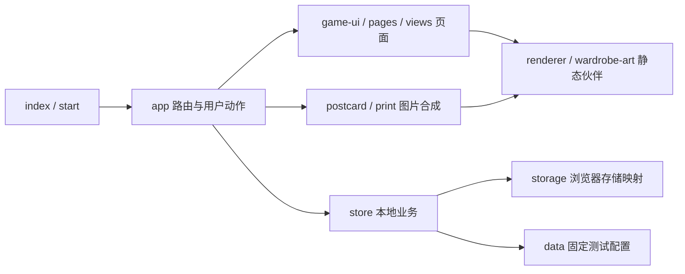

# 后端研判说明

2026-11-13：先运行页面、理解业务，再评估架构。本轮已恢复与最新完整源码一致的游客端，未预先实施关闭购买或重构。后端语言、数据库、认证和 HTTP 路径均未冻结；旧 Node/PostgreSQL 实验不进入本包，避免误认为必须沿用。依据见[业务规则](业务规则.md)。

## 代码如何工作

[start](../design/demo/start.mjs) 导入 [app](../design/app.mjs)，通过 [profile](../design/demo/profile.mjs) 装配当前视觉、图片合成和存储。app 负责路由、草稿、取消返回及异步保护，目前仍是较大的控制器；后续随接口按功能拆分，本轮不重写框架。

change/tx → store.commit 在内存复制后一次写 localStorage，只能处理本地事务，**没有数据库并发、防作弊或可信身份保证**。没有业务 HTTP 客户端；下载图片的 fetch 不代表服务已接入。渲染负责画面，不能承担正式结算。

## 数据与归属

当前 db 为 `{version, current, accounts}`；账号字段如下。这是现状，不是要求后端保存整份 JSON 或照抄表结构。

| 字段 | 当前含义 | 后端设计要解决 |
| --- | --- | --- |
| name / initialized | 本地身份、初始化 | 真实 accountId、会话、一次初始化 |
| owned / look | 资产 ID、保存搭配 | 归属、槽位／兼容、版本冲突 |
| gifts / claimed / unlocked | 免费领装、资格、解锁 | 账号／景区唯一约束和请求重放 |
| balance / ledger | 次数及变动 | 分景区钱包、原子收支、一致与审计 |
| events / draws | 经历、到访时搭配、抽取 | 可信凭证、结果可查、防重 |
| works | PNG、标题、经历／搭配快照 | 私有存储、归属、固定快照、文件提交 |
| orders | 当前模拟订单及结算记录 | 原型可模拟购买，正式首发不开放；迁移另定 |

## 操作与接口责任

| 操作 | 当前入口 | 后端职责与错误要求 |
| --- | --- | --- |
| 登录／退出 | app 的 login/logout | 真实认证和会话撤销；拒绝、过期、限流可恢复原目标，不能假成功 |
| 目录／进度 | data / readDB | 已发布目录、素材版本、本人状态；区分读取失败与空账号 |
| 初始化 | initialize | 授予全部初始资产、保存默认搭配；重试不重置 |
| 见面礼 | gift | 校验景区资格并授予；重复不多发、不覆盖搭配 |
| 到访／活动 | checkin / activity | 凭证与店员权限；经历、资格、发次、解锁原子提交；重试与再次到访区分 |
| 抽取 | draw / eligible | 服务端随机、跨池排重、扣次入库和结果查询；锁池／收齐／缺次不扣，超时不能再扣 |
| 保存搭配 | saveLook | 本人拥有、槽位兼容、版本冲突；保留设备草稿 |
| 模拟购买 | createOrder / pay | 当前原型的套餐、订单与幂等到账参考；正式首发不开放，不作为支付接入要求 |
| 作品 | saveWork / composeImage | 准备可信来源、受限上传、文件验证、固定快照与私有读回；处理失败和未知提交 |

路径和字段共同评审，形成版本化接口与脱敏样例。至少明确身份来源、sceneId 范围、稳定 assetId、请求防重、错误码、时间时区、分页、配置／搭配版本和超时查回。

前端负责交互、试穿、预览及草稿；后端不信任客户端余额、奖品、到场结果或账号归属。正式图片不继续随整份账号 JSON 存浏览器；浏览器合成是候选，需共同决定像素可信度、跨域、上传与提交恢复。

## 请同事反馈

1. 架构选型及取舍；真实身份、续期、退出和四种运行环境如何支持。
2. 地点和店员核验的可信来源，是否需要独立操作端／外部系统。
3. 实体、唯一约束和事务如何处理钱包、首次资格、抽取和多设备并发。
4. 景区、池、资产、地图锚点及模板由谁维护、校验和发布。
5. 文件如何上传、固定、私有读回、清理，如何避免半保存。
6. 环境、域名、日志、恢复、资源要求和双方负责人。

首条联调链路建议为真实登录 → 初始化 → 免费领装 → 保存搭配 → 另一设备读回，再接核验、抽取、作品及动画。测试替身隔离使用，真实接口失败不可退回本地自行结算。
