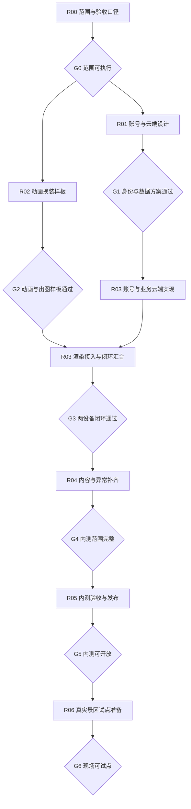

# 黄晓西开发实施任务与里程碑

版本：内测实施计划 v1.0。更新日期：2026-11-08。状态：**计划已细化，任务尚未实施，阶段决策尚未全部完成**。整理基线为 `3df7f3d`。用户确认日期、人员与服务器／域名暂未确定，因此按依赖和阶段验收编排，不承诺日历工期。

## 1. 如何使用这套计划

| 文件 | 唯一职责 |
| --- | --- |
| 本文 | 范围、决策关口、阶段目标、依赖、责任及执行控制 |
| [内测实施任务详表](内测实施任务详表.md) | 45 项任务的输入、步骤、交付、验收映射和失败／回退处理 |
| [内测验收用例与发布清单](内测验收用例与发布清单.md) | 可操作的验收用例、测试数据、性能测量、发布和恢复标准 |

本计划安排“何时完成什么”，字段与接口的最终定义仍写入[数据契约](数据模型与业务接口契约.md)，角色协议写入[渲染规范](素材与渲染接口规范.md)，页面规格写入[交互标准](完整体验与验收标准.md)。实施任务必须同步这些权威文件，不能让计划成为另一份相互矛盾的 PRD。

标记口径：**已确认**为用户决定；**实施要求**为保证已有规则成立所需约束；**建议默认**可评审、尚非产品决定；**待决策**在相应关口解决。任务状态全部从“待开始”起，不因计划详尽就标成完成。

## 2. 交付目标与边界

用户已确认：

1. 先做真实账号与云端进度的内测版，再进入真实景区试点。
2. 使用独立手机网页，后续接入黄晓西。
3. 首批内测伙伴必须有待机、眨眼和点击回应等连续动画。

最终内测效果：用户通过实际身份验证进入，在线领取服装，在明确标识的测试点位核验并获次／解锁，抽取、试穿并保存，使用有动画的伙伴制作和保存静态纪念图；换到另一台设备登录后，库存、景区次数、经历、保存搭配和作品一致。体验继续采用已确认的黔山同行场景与三主场景结构。

| 能力 | R03 工程样板 | R05 开放内测前 | R06 试点进入条件 |
| --- | --- | --- | --- |
| 身份／数据 | 真实身份、服务端归属、一个完整云端闭环 | 登录恢复、跨设备、异常与账号隔离通过 | 按试点所需决定是否接黄晓西身份 |
| 内容规模 | 建议一个景区、一个可操作点／池／纪念模板；规则测试使用共享池等扩展夹具 | 覆盖现有四点、独立活动、两池、六套确认款式及两模板；生产适配数量若调整需确认，不能暗减 | 真实点位、商家、活动、背景和运营配置核实 |
| 动画 | 一个母版、两套轮廓不同服装的技术样板；不是可对外内测成品 | 全部投放服装兼容必要动画、静态导出和移动设备 | 现场设备与弱网适配通过 |
| 核验 | 受控测试凭证；后端真实执行规则，界面和经历标明测试 | 测试核验与生产凭证分环境，不能声称已防远程作弊 | 真实到场与店员凭证方案经现场验证 |
| 付费 | 默认建议保留隔离的模拟订单，范围 D04 决定 | 免费主线完整；真实支付是否进入由 D04 决定 | 若实际收费则先完成真实支付、对账与失败处理，不能用演示成功按钮 |
| 运营 | 可校验、可审计的配置发布与查询工具，不默认造后台页面 | 能定位内测问题、回退配置和恢复数据 | 店员与运营有真实权限和最小操作端 |
| 回忆 | 保存来源快照和真正图片文件 | 两模板、跨日筛选、旧作品固定、真机保存／分享降级 | 真实素材与地点一致，授权范围可追溯 |

“真实”指身份、存储和业务事务真实；内测中允许的测试核验必须保留标识。跨设备同步的是已保存业务数据；未保存衣橱／制作草稿默认只在本设备按账号保护，是否跨设备恢复草稿列入 D07，不擅自承诺。

不自动纳入：宠物、社交好友、任务领取／强制路线、手动结束旅程、视频生成、实体下单、稀有度／保底、全功能管理后台、完整 GPS 轨迹。试点也不等于全部后置能力一次上线。

## 3. 开工前后必须作出的决定

每项决定记录选项、依据、影响、确认人和日期。未决定时可以做其不依赖的工作，但不能擅自采购、锁定技术或通过对应关口。

| 决策 | 最迟关口 | 需要形成的答案 | 建议与影响 |
| --- | --- | --- | --- |
| D01 登录与恢复渠道 | G1 前 | 首批一种可验证登录方式；回访、失效、找回／绑定冲突怎么处理；未来黄晓西身份如何映射 | 先打通一种真实方式，再扩多渠道；不把设计稿中的手机号／微信当成已选定 |
| D02 环境与部署资源 | G1 前 | 资源归属、域名与 HTTPS、身份服务、数据库、图片存储、凭证管理、费用边界 | 比较现有可用资源后决定；不在计划阶段指定供应商或购买 |
| D03 动画生产路线 | G2 前 | 母版和源文件由谁提供／制作；候选技术、工具授权、交付格式、维护能力 | 用实际样板决定；不得把截图当成已有骨骼／可变形源文件 |
| D04 付费进入阶段 | G0 前确定内测边界；真实接入前补渠道 | 内测免费闭环＋模拟订单，还是必须真实收款；各自界面及数据隔离 | 推荐先免费主线＋模拟订单；真实支付另立依赖，未确认前不删除原购买流程 |
| D05 目标用户与设备 | G0 前 | 邀请范围、并发预估、实际 iPhone／Android／浏览器、联系人及反馈方式 | 资源未定时先写候选矩阵；没拿到真实设备不能以桌面模拟代替放行 |
| D06 首批资产范围 | G2 前确定样板，G4 前确定投放 | 固定脸部、两套验证款、服装／表情／姿势兼容表；六套量产及预算安排 | 六套既有款式为内容基线，数量调整须确认；不能静默以两套替代全内测 |
| D07 数据与草稿政策 | G1 前 | 演示存档是否导入；新账号初始进度；本地草稿保留、退出、注销／删除申请处理 | 建议正式账号新建云进度，演示原档独立保存；任何迁移需可信归属校验 |
| D08 测量与恢复目标 | G0 提候选，G2/G5 前分别冻结 | 性能阈值、内测负载、保存容量、可接受数据恢复点／恢复时长、日志保留 | [验收清单](内测验收用例与发布清单.md)给建议测量方案，不把建议数字当已验证 SLA |
| D09 图片生成与可信范围 | G1 建方案，G2 样板后定 | 浏览器／服务端渲染及上传流程、图像来源校验、版本复现、私有读取方式 | 来源元数据可信不代表上传像素可信；不能用哈希或 inputStamp 冒充真实性证明 |

登录、渲染、存储三项选择分别写短决策记录，列明放弃方案原因及后续替换范围。技术选型时查询当日官方资料、授权和兼容性，记录时间；本轮未替代该调查。

## 4. 阶段顺序、目标与放行关口

R01 和 R02 可按资源同期推进；这不表示已经安排两组人员。单人实施时先交替完成高风险验证，再扩写代码。G1 通过后可开始后端与账号工作，但 G2 未过不能宣称动画衣橱已就绪，G3 必须同时具备云端与动画结果。

| 阶段／任务 | 游客或业务方应看到的效果 | 必须交付 | 放行要求 |
| --- | --- | --- | --- |
| R00：01—05 | 团队对“本次内测做什么”无歧义 | 范围表、决策台账、设备／角色分工、基线、验收映射 | G0：D04/D05 有执行口径；其他决策有责任方和最迟时点；没有混入未经确认功能 |
| R01：01—06 | 登录、恢复、数据和异常路径有完整设计 | 账号状态／页面、数据归属、事务及图片保存方案、环境／接口草案、技术决策 | G1：D01/D02/D07 已定；D09 有可验证候选；接口写范围、失败和身份边界可测试 |
| R02：01—06 | 同一伙伴穿两种服装能自然动、点击回应并导出 PNG | 母版、源文件、适配表、可运行样板、真机数据、选型结论 | G2：三类连续动作＋跨套适配＋三处一致＋真机＋出图全部通过；不能以静态图或录像替代 |
| R03：01—10 | 一位真实用户从登录走到跨设备回看纪念图 | 最小服务、真实账号、原子业务、动画渲染、作品云存储及贯通录像／记录 | G3：正常用户路径无控制台改数据；两设备一致、另一账号隔离、重试不多发不多扣 |
| R04：01—06 | 现有游玩内容与所有常见状态能完整体验 | 多点／共享池、商家活动、全首批衣服、手账／订单、配置维护、全页状态 | G4：完整范围及异常均有结果；收齐、次数不足、未到访、错误、回访无断路 |
| R05：01—07 | 邀请用户能自行进入、玩完整主线、反馈问题 | 集成／权限／真机测试、备份恢复、发布包、运行说明、试用反馈 | G5：必测用例通过，阻断问题为零，日志和恢复真实演练，发布负责人记录放行 |
| R06：01—05 | 游客、店员和运营在真实地点完成职责 | 真实配置／素材、现场核验、店员权限、条件支付、试点结果 | G6：现场各角色独立走通，模拟能力不冒充真实，错误和支持路径可用 |

任务级细节见[45 项任务](内测实施任务详表.md)。关口通过记录须包含提交、配置／素材版本、证据、已知限制、验证人和日期；失败返回对应任务，不以“基本完成”跳关。

## 5. 分工、排程与任务状态

| 职责 | 负责结果 | 当前安排 |
| --- | --- | --- |
| 产品确认 | 范围、账号体验、素材方向、预算和阶段效果 | 用户；有业务方意见时归入同一决策台账 |
| 实施 | 模型、选型证据、代码、接口、部署和自测 | Codex 可承担工程工作；外部服务权限与实际负责人员待定 |
| 美术／动画 | 可编辑母版、拆件、绑定／变形、动作、兼容与源文件 | 未确定，不假定 AI 生成图已解决生产流程 |
| 验收 | 规则与异常检查、独立视觉轮次、真机操作、缺陷记录 | 实施者先自验；体验方向和关键素材由用户确认，真机执行人待定 |
| 发布／现场 | 环境管理、回退、试点商家和运营支持 | 待 R00/R06 明确，同一人可兼任但责任不能缺席 |

状态统一为：待开始 → 就绪 → 执行中 → 待验收 → 已验收；缺少依赖标“受阻＋原因＋可继续任务”，失败回执行中。只有交付物和证据齐全才记“已验收”。“文档评审通过”“样板通过”“开放内测”分开记录。

开工就绪条件：该任务的前置已通过、必要决定明确、输入文件可访问、负责人已定、验收环境可用。每任务按“契约／场景 → 小实现 → 测试及截图 → 更新文档 → 提交”完成，不一口气铺全产品再验证。

暂不估日历工期。R00—R02 结束后，把每任务剩余实现、联调、验收返工与外部等待分别估算，再依据实际人力排期；关键路径通常取账号／环境与动画生产两线中较慢的一线。日期目标新增时先评估范围和资源，不倒填不可能的承诺。

## 6. 工程实施共性要求

- 保留冻结演示与现有素材源文件。正式应用和演示在入口、配置、存储与服务权限上明确隔离；正式接口不可读取浏览器 A/B 选择作为身份。
- 从现有 app/store/data/profile/renderer 接口定位增量拆分。共享规则不能复制成两份相互偏离的实现，发布资源清单从实际依赖生成。
- 查询不写数据，页面不自行加余额或发资产。抽取结果、首次奖励和订单到账由服务端事务与唯一约束保证，失败没有半笔状态。
- 单次操作请求有身份、输入、请求 ID 与结果；响应丢失后查原结果，不把新请求当重试。余额／库存／经历显示基于已确认服务端结果。
- 保存搭配采用版本冲突检查；账号级拥有和景区余额分开。跨景区或两卡池同时抽取仍要防同资产重复拥有；不只锁单个池。
- 未保存草稿在本设备按账号保护。保存后设备间读取最新状态；旧页不能用过期快照回写覆盖。返回路径包含完整来源和参数。
- 用户作品文件与元数据采用可恢复提交；正式“已保存”只在完整完成后出现。缓存 URL 到期不等于作品被删除，旧图不因换装或升级重新渲染。
- 真实账号敏感操作要校验身份，资源读写逐次校验所有者；对象路径难猜不能代替授权。[OWASP 身份验证](https://cheatsheetseries.owasp.org/cheatsheets/Authentication_Cheat_Sheet.html)与[授权检查](https://cheatsheetseries.owasp.org/cheatsheets/Authorization_Cheat_Sheet.html)作为方案审查依据。
- 角色动画管理页面前后台、资源加载和释放；图片合成验证可导出及空结果处理。依据为 [MDN 页面可见性](https://developer.mozilla.org/en-US/docs/Web/API/Page_Visibility_API)和 [Canvas 导出](https://developer.mozilla.org/en-US/docs/Web/API/HTMLCanvasElement/toBlob)，具体渲染引擎仍待样板选择。
- 本轮只做计划文档。以上要求不表示已有服务、动画或真实设备验收已经完成。

## 7. 变更、风险和回退

| 风险 | 尽早验证的位置 | 出现问题时的处理 |
| --- | --- | --- |
| 没有可生产动画的源素材／人员 | R00-03、R02-01 | 补素材制作安排和样板预算；可继续账号设计，不能扩大衣服数量掩盖问题 |
| 登录或云资源不可用 | R01-01、R01-05 | 调整实际渠道／环境决策；保持服务接口，不能把演示登录包装为真实身份 |
| 动画换装混搭或 PNG 不成立 | R02-03—05 | 修母版／兼容／渲染路线；能力不足不通过 G2，缩减体验范围须用户确认 |
| 同账号并发导致重复资产或负余额 | R03-06、R05-02 | 停止该能力放行，修事务／约束与重试；不靠刷新页面补偿 |
| 作品图片丢失、跨账号可读 | R03-08、R05-02/04 | 保留原图和来源，修存储授权／提交机制；禁止静默重新生成旧作品 |
| 六套适配成本超预期 | R02-06、R04-03 | 以样板数据重估，明确是否分批内测；未经确认不减少承诺 |
| 真机出现卡顿、白屏、无法保存 | R02-05、R05-03 | 定位具体设备与资源；优化后原设备复测，静态降级只能是故障反馈，不能替代必需动画 |
| 实地资源、商家支持不足 | R06-01/03 | 只保留内测交付，不宣称已上线景区；安排运营及现场验收后试点 |

每次变化记录影响的任务、页面、数据、资产、测试及估算。业务范围、费用、技术路线和不可逆数据处理交用户确认；常规实现自主完成。回退分代码、配置、素材与数据四项，旧数据仍可读；有新写入后不能不经处理恢复旧数据库快照造成丢失。

## 8. 本计划的完成标准

计划本身验收：45 项任务均有依赖／目标／具体工作／交付／验收／异常回退；所有阶段有放行条件；业务主线、真实账号、动画和云端写入均有用例；未决选择明确归口；当前页面结构和原有确认规则不被暗改。

实际产品完成以 G5 为准；G6 是另一次现场交付。下一轮从 R00 的决定和资源清单开始，随后执行 R01／R02。文档评审与用户确认不能代替后续技术、视觉和真机验收。

本轮文档自检已完成：[计划覆盖与依赖检查](../output/planning/2026-11-08/plan-review.json)核对 45 项任务、61 项用例、字段完整性、依赖无环、规则保持和零应用改动；[文档检查](../output/planning/2026-11-08/docs-check.json)核对本地引用与格式。以上是计划检查，61 项产品用例仍待后续实际执行。
