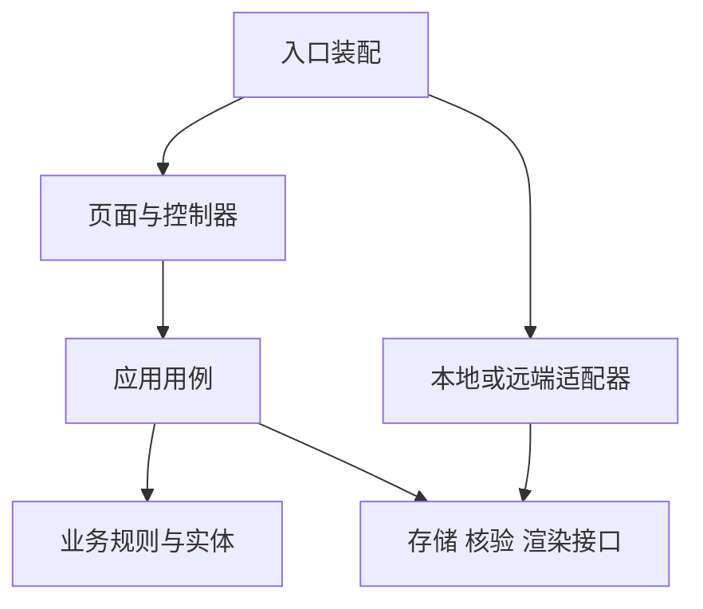

# 黄晓西模块架构与代码组织

更新日期：2026-11-08。状态：后续实施设计，尚未完成代码拆分。业务依据为[产品规则](一期产品规则与业务流程.md)，页面依据为[页面与模块目录](页面模块与初始化范围.md)。

下一阶段先确定真实账号／云端方案和动画换装技术样板，再围绕第一条云端闭环逐模块拆分。现有原生 ES modules 用作迁移基础；技术栈与渲染方案通过对应样板确定。阶段顺序和验收见[实施计划](开发实施任务与里程碑.md)。

客户演示入口通过 profile 注入渲染、存储映射、订单与核验页面，和原型共用交互控制器、领域用例及配置。新增模块与依赖见[客户演示代码索引](../design/demo/README.md)。

## 当前结构与需要拆分的职责

| 当前入口 | 已有职责 | 增量拆分方向 |
| --- | --- | --- |
| `design/app.mjs` | 路由、守卫、UI 会话、交互分发、部分页面和弹层 | 先提取导航／编辑上下文，再按功能迁出页面与控制器 |
| `design/game-ui.mjs` | 11 类场景化页面渲染 | 按页面或紧密相关的页面组拆分，保持现有布局 |
| `design/store.mjs` | 业务规则、账号结构校验、本地读取与提交 | 分开领域规则、用例事务和存储适配 |
| `design/data.mjs` | 单景区固定配置、资产及索引 | 保留集中配置，增加配置引用校验，解除业务对测试常量的直接依赖 |
| `design/style.css` | 公共基础与全部页面样式 | 提取设计变量和基础组件，页面样式使用独立作用域 |
| `design/visual.mjs`、`design/world.mjs` | 伙伴、场景与图标示意 | 用统一渲染接口承接当前示意与未来素材 |
| `design/postcard.mjs` | PNG 合成 | 保持合成独立，显式传入搭配、素材版本、经历和模板 |

这些是拆分入口，不要求一次搬迁全部代码。未触及模块保持原样；迁移中的单一功能不能同时维护两套业务规则。

## 业务边界

| 模块 | 拥有的职责 | 不承担的职责 |
| --- | --- | --- |
| M01 入口与会话 | 演示身份、初始化前置条件、恢复目标 | 奖励结算、作品合成 |
| M02 景区与点位目录 | 景区、点位、商家、活动、卡池关系的只读查询 | 修改游客余额与库存 |
| M03 到访与领奖 | 核验结果、到访事件、首次领奖资格、解锁协调 | 模拟支付、UI 导航 |
| M04 卡池与次数 | 候选集合、扣次入库、流水、模拟订单 | 调整搭配、假造到访 |
| M05 衣橱与收集 | 资产拥有查询、搭配合法性、收藏进度 | 抽奖发物、修改历史作品 |
| M06 回忆与作品 | 经历筛选、制作输入、输出和作品快照 | 发奖、将浏览记录变成足迹 |
| M07 公共界面与配置 | 导航、弹层、格式化、设计变量、测试配置装配 | 独立持有另一份业务真相 |

到访需要同时写事件、资格、余额及解锁，抽取需要同时扣次和入库。这类跨职责写入由用例统一提交，不由多个模块各自保存一遍。

## 依赖方向



业务规则不导入 DOM、浏览器路由或 localStorage。用例依赖接口，由入口注入本地实现；之后接远端服务替换适配器。页面只接收查询视图或操作结果，不直接调用底层持久化写余额。

建议按下面的目录逐步落地；它是目标布局，不是当前已存在文件清单：

```text
design/
  app.mjs                    # 入口装配，迁移完成后保持薄层
  src/
    app/                     # 路由、守卫、上下文、公共错误处理
    features/
      entry/ catalog/ visits/ draws/ wardrobe/ memories/
                             # 各功能的页面、控制器、局部样式
    domain/                  # 实体、规则、状态与错误定义
    application/             # 查询与命令用例、事务编排
    ports/                   # 存储、核验、角色渲染、图片输出接口
    adapters/                # browser-storage、demo-verification 等实现
    config/                  # 当前测试配置与引用校验
    rendering/               # 示意绘制、素材适配和 PNG 合成
    shared/                  # 已经实际复用的组件、基础样式与工具
  tests/
```

已有文件在迁移期间可作为兼容导出入口；迁移后移除过时实现，不能保留两份可写业务入口。目录深度根据实际规模调整，不为每个函数建一层。

## 状态与接口边界

| 状态 | 唯一责任方 | 页面行为 |
| --- | --- | --- |
| 资产、余额、领奖、事件、订单、作品 | 业务存储，通过用例修改 | 展示结果，不能自行预测为成功 |
| 当前保存搭配 | 搭配用例与存储 | 首页及新图读取同一搭配 |
| 试穿与制作草稿 | 按账号隔离的 UI 会话 | 允许预览；保存、放弃、继续编辑明确区分 |
| 返回地址、参数和来源 | 导航上下文 | 保存完整路由，不只记录页面名称 |
| 生成预览与忙碌状态 | 制作控制器 | 绑定制作输入；输入变化后失效，失败可重试 |

具体字段、命令和错误见[数据与业务接口契约](数据模型与业务接口契约.md)。样式使用页面根类或模块前缀，不以裸 `button`、`img` 等选择器改写其他页面。公共基础样式的变更必须检查受影响页面。

## 迁移与回退

1. 记录当前页面及测试基线，先迁出一个页面与控制器，验证原路由、返回和草稿保持。
2. 提取本地存储适配器及用例边界，仍读写原键与原数据结构。
3. 分批提取领域规则和其他页面，不同时更改产品流程、数值或素材。
4. 每批验证后再推进；模块变化更新索引，提交范围保持可单独回退。

UI 拆分不得通过换存储键、重置账号或修改历史作品来实现。未来结构迁移先保留恢复副本并验证兼容读取；存在不可逆数据变化时，不承诺单纯回退前端文件就能恢复，必须另备迁移恢复方案。

本地存储不具备生产并发事务和防篡改能力。未来服务端需承担权威身份、核验和原子结算，前端模块化完成不等于这些能力已完成。
