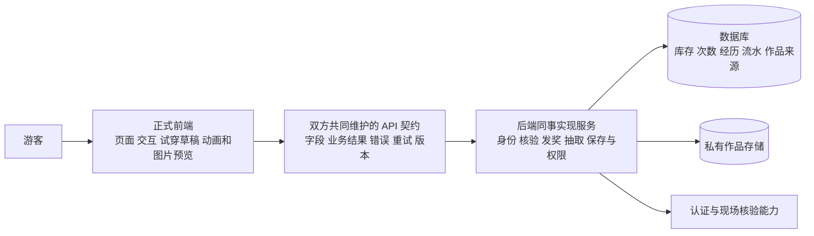

# 正式前端拆分与后端协作方案

日期：2026-11-12。审查基线 `98df47c`，本轮是研判与实施方案，不是前端重构或上线交付。运行源码、素材、当前演示存档均未修改；本文中的 `frontend/`、`contracts/` 和 `dist/` 是目标，尚不存在。

## 1. 结论与本轮确认

应从现有成果提取一个独立的正式游客前端：保留黔山同行视觉、三个主场景、衣橱编辑与纪念图呈现；将身份、到访资格、余额、库存、抽取、作品记录等权威操作改为调用后端。不能把演示目录直接打包，也不能只隐藏几个测试按钮就称为上线版本。

用户已确认：

- 用户一侧负责前端，开发同事负责后端；后端技术栈、登录实现和接口规范尚未共同确定。之前的 Node/PostgreSQL 只是候选，不对同事形成技术限制。
- 交付面向实际上线，不含早期演示内容。旧演示保留作历史参考，不进入正式前端交付包或部署资源。
- **首个正式版本先上线免费游玩，购买次数暂不开放。** 不上线模拟支付，也不在没有真实支付时留下无效购买入口。原型／旧内测的模拟购买记录保留原日期，不能覆盖这次决定。

保留的产品要求：固定伙伴身份、全部初始装扮免费、领装与穿戴分开、到访与在线浏览分开、景区通用次数、首次奖励、跨池排重、收齐不扣次、随时制作回忆、旧作品固定。iPhone／Android 系统浏览器和微信内的体验要求、连续动画要求没有被本轮取消。

“正式前端工程可交接”与“产品可公开上线”分别验收：前者要求真实 API 边界和独立工程；后者还需真实认证、核验、云数据、正式配置／素材、动画和实机。当前这些条件未全部具备。

## 2. 当前代码的实际问题

| 位置 | 本轮实际观察 | 正式化改法 |
| --- | --- | --- |
| [app.mjs](../design/app.mjs) | 点击处理直接调用 `S.initialize/gift/checkin/activity/draw/pay/saveLook/saveWork`，通过 `tx/commit` 改浏览器数据；守卫、草稿、页面和测试动作混在一起 | 拆路由／会话、功能控制器和 API 服务；所有权威写入异步等待后端结果 |
| [store.mjs](../design/store.mjs) | localStorage 保存整份账号；抽取随机数、去重、扣次、首次资格和模拟付款均在前端 | 作为业务参考和测试用例输入交接；正式前端不打包这套结算实现，后端按契约独立实现事务 |
| [data.mjs](../design/data.mjs) | 一个测试景区、四点、活动、两池、价格、固定码集中在 JS；多个页面直接引用 | 改为后端目录和用户进度查询；前端只保留展示常量和素材映射，不保存可用于发奖的测试码 |
| [profile.mjs](../design/demo/profile.mjs) | 新视觉、演示存档映射、核验／订单页面一起注入共享控制器 | 提取正式视觉与渲染装配；不通过 `demo=true/false` 让正式包携带两套行为 |
| [game-ui.mjs](../design/game-ui.mjs)、[演示页面](../design/demo/visual/pages.mjs)、[详情](../design/demo/views.mjs) | 主场景可复用，但仍引用本地规则／固定点位，含演示身份和模拟操作 | 按功能拆页面，接只读视图数据与明确动作；界面不直接写余额、资格或库存 |
| [renderer.mjs](../design/demo/renderer.mjs)、[人物装配](../design/demo/wardrobe-art.mjs) | 使用服装图集与旧 hifi 图标／背景，按固定 ID 和路径取图；是静态渲染 | 抽到独立 rendering 与素材清单；保留业务 assetId，解除历史目录依赖；动画样板仍单独验证 |
| [theme.css](../design/demo/visual/theme.css)、[map-art.mjs](../design/demo/map-art.mjs) | CSS 仍引用 hifi 背景，地图位置和取景写死四个示意点 | 收拢真实依赖，拆主题／组件／页面样式；地图锚点、地点取景由配置映射，示意图不能冒充真实景区信息 |
| [纪念图合成](../design/demo/postcard.mjs)、[绘制](../design/demo/visual/print.mjs) | 浏览器 Canvas 合成，PNG 字符串随作品存本地 | 前端保留预览／合成接口；后端准备可信来源、授权上传、最终提交及私有读回；旧 PNG 不重画 |
| [stage](../design/demo/stage.html)、[演示存储](../design/demo/storage.mjs) | 投屏控制、A/B、导入／复位、演示批次 | 全部排除正式入口和构建依赖；历史存档迁移另做受限工具 |

当前唯一看到的 `fetch` 用于把作品图片转为下载／分享文件，不构成业务 API 接入。上一轮 [specs/alpha](../specs/alpha/README.md) 是契约验证和只读迁移预检，不是后端，不可直接当生产服务交接。

## 3. 前后端如何分工



| 能力 | 前端责任 | 后端责任 |
| --- | --- | --- |
| 登录／初始化 | 输入与状态反馈、深链恢复、初始化选择、会话过期后的恢复 | 验证真实身份、生成稳定 accountId、会话撤销、一次初始化与初始资产授予 |
| 景区／地点／卡池 | 地图、详情、收集进度和前置说明 | 返回可投放目录、稳定 ID／关联、内容版本及当前用户状态 |
| 到访／活动 | 收集必要凭证、定位权限反馈、提交确认、显示真实结果 | 判断凭证／到场／店员权限；事务记录经历、首次资格、发次及解锁 |
| 抽取／余额 | 明确确认消耗、请求中的交互、展示服务返回奖品、刷新关联状态 | 原子检查池和资格、排除全局拥有、等概率抽取、扣次和入库；结果可重查 |
| 换装 | 选择／取消／试穿、保护草稿、渲染、保存冲突反馈 | 校验拥有与兼容、按 lookRevision 保存；防止旧设备覆盖新搭配 |
| 回忆／图片 | 选经历与模板、生成预览、上传、保存／分享交互 | 校验来源与归属、固定快照、私有文件授权、作品提交与读回、清理和恢复 |
| 配置／素材 | 提供渲染 manifest、支持的槽位与模板、素材加载错误处理 | 校验运营配置引用和发布版本，不下发客户端无法解释的内容；历史版本可追溯 |
| 运营与店员 | 游客端不提供“我已完成消费”等成功按钮 | 提供可信核验或对接既有店员系统；若需新店员操作面，双方明确负责人及最小范围，不能默认为游客端已包含 |
| 生产发布 | 可重复构建、发布资源、前端错误和浏览器验收 | HTTPS/API 网关、环境权限、数据库／存储、日志、备份、服务发布与恢复 |

前后端都可为反馈检查格式；最终业务判定只在后端。禁止后端只保存浏览器算出的奖品／余额。素材引擎与后端语言分开决定，不用后端数据库结构直接作为页面数据对象。

## 4. 正式前端工程目标

建议沿用现有原生 JavaScript ES modules＋JSDoc，先按职责拆分，不因协作重写成 React/Vue 或切换语言。新增可重复的生产构建值得做：把正式入口及依赖收敛到独立产物，检查资源路径和演示泄漏。轻量构建工具如 Vite 是候选，待实施时锁定实际版本与依赖；本轮没有安装，也没有现成 `npm run build` 可执行。

Vite 官方说明生产构建可输出静态部署产物，但动态拼接资源地址仍需处理；环境变量注入前端后可见，不能存短信／存储等服务密钥。具体浏览器目标还需按本项目四环境实测，不能凭默认构建宣称兼容。[生产构建](https://vite.dev/guide/build.html)、[环境变量](https://vite.dev/guide/env-and-mode.html)

```text
frontend/                         # 独立安装、启动、构建、测试的正式前端
  index.html
  package.json + 对应 lockfile
  .env.example                    # 公开 API 地址等说明，不含任何密钥
  src/
    app/                          # 入口、路由、前置守卫、公共错误处理
    features/
      auth/ onboarding/ companion/ catalog/
      visits/ draws/ wardrobe/ memories/
                                  # 各自页面、交互控制、局部样式
    api/                          # 唯一 HTTP 客户端与按业务划分的服务方法
    state/                        # 会话、服务数据缓存、按账号隔离的本地草稿
    rendering/                    # 伙伴渲染、确定帧、纪念图合成
    assets/                       # 经核实的正式运行素材及 manifest
    styles/                       # 公共主题、基础组件
  tests/                          # 自动化测试；不进入发布产物
  dist/                           # 构建输出；只发布此目录，非整仓
contracts/
  openapi.yaml                    # 双方唯一接口定义，尚待共同评审生成
  examples/                       # 脱敏请求、响应与错误样例
  CHANGELOG.md                    # 契约版本和兼容变更
docs/handoff/
  README.md                       # 给同事的启动、对接、验收与发布说明
```

后端可独立选择语言／框架。仓库组织建议先同仓分目录并划分负责范围，便于接口变更同一 PR 评审；前后端仍独立构建和部署。如果同事需要独立后端仓库，则用固定版本的契约交接，不在两仓各写一份不一致文档。是否两个仓库不阻止先完成接口和模块边界。

历史 `design/`、`research/`、`reviews/` 和原 `output/` 保持原样。交给同事的正式源码包只含 `frontend/`、`contracts/`、必要交接说明及正式素材，不混入演示页面／历史截图／演示存档。素材通过实际依赖提取，原件作为历史保留，不制造两份继续各自修改的正式源代码。

## 5. 接口先约定到什么程度

建议使用 HTTP＋JSON，并用 OpenAPI 3.1 系列共同描述请求和返回；确切版本按双方工具支持固定。OpenAPI 与后端编程语言无关，适合双方依据同一描述开发和校验。[官方规范](https://spec.openapis.org/oas/v3.1.1.html)

当前候选 HTTP 见[数据契约](数据模型与业务接口契约.md)，不能直接视为已定协议。之前的 `createDemoOrder/settleDemoOrder/cancelDemoOrder` 不进入正式首发契约。具体路径可由双方评审，不能只列路径不给结果和错误语义。

| 首批接口组 | 至少约定的输入／返回 | 需覆盖的失败 |
| --- | --- | --- |
| 认证、会话、退出 | 实际登录凭证；可信 accountId、初始化状态、会话信息 | 过期、拒绝、撤销、限流；不信任客户端 accountId |
| 目录与素材清单 | sceneId、目录／manifest 版本；景区、点、活动、池、套装、资产、素材引用、地图类型与锚点 | 未发布、下架、未知 ID、资源版本不支持；不默认替换到测试景区 |
| 用户进度查询 | 全局拥有、已保存 look／lookRevision；按景区钱包、资格、解锁和进度版本 | 服务异常不能返回假空账号；区分未初始化与读取失败 |
| 初始化、景区免费领装 | starterId 或 sceneId、requestId；实际授予项、保存状态、最新版本 | 重复请求返回同一次结果；领装不覆盖搭配或产生到访 |
| 到访、活动核验 | sceneId／pointId 或 activityId、真实 proof、requestId；经历、实际奖励、解锁、最新余额 | 核验失败、权限不足、已领奖、无效凭证、结果未知；重复到访与重复请求区分 |
| 抽取、结果查询、流水 | sceneId／poolId、requestId；drawId、assetId、剩余次数、版本及可查询结果 | 未解锁、收齐、余额不足、重试冲突；候选集合和随机由后端决定 |
| 保存搭配 | 完整 look、expectedLookRevision、requestId；保存后的 look 与版本 | 未拥有、槽位／兼容错误、版本冲突；保留草稿 |
| 经历、作品列表与详情 | 景区／日期／分页游标；稳定 ID、时间、展示快照、读取权限 | 跨账号拒绝；稳定排序、下架对象的历史信息仍可读 |
| 作品准备、上传、提交 | visitIds、已保存搭配版本、模板／素材版本；preparationId、受限上传目标；最终 workId | 上传失败、图片无效、输入过期、提交未知、签名链接失效；不可半保存 |

契约附录必须明确：所有 ID 为稳定字符串；账号与景区的归属范围；UTC 时间传输及显示时区；分页／空值／枚举；统一错误码、请求关联和版本冲突；配置、素材、模板和搭配版本各自含义；哪些字段由后端生成。页面模型从 DTO 转换，不直接绑定数据库表。

推荐 `/api` 同域网关：前端静态文件与后端服务仍分别部署，通过网关统一访问，减少跨站会话复杂度。Cookie 或 token、刷新／撤销、CSRF、跨域与上传策略由双方在真实登录方案中定；不得把长期密钥放前端。不同域部署也能实现，但须额外验跨域与四环境会话。

统一 API 客户端负责请求 ID、超时、错误翻译、会话过期和响应归属。读取可有限重试；发奖／扣次等写入超时后先查询原请求，不创建新 ID 自动再做一遍。页面离开或取消动画不等于服务事务取消，迟到响应不得覆盖新账号或新草稿。

图片合成可先沿用浏览器实现作为候选：服务准备真实来源→前端按确定版本渲染 PNG→上传到授权临时键→后端校验并固定文件→提交作品→读回。跨域素材必须支持 Canvas 导出；凭据过期可重取而不重画旧作品。客户端上传像素的可信程度仍按 D09 决定，哈希不等于画面真实性证明。

## 6. 必须从正式包排除的内容

| 内容 | 正式首发处理 |
| --- | --- |
| stage／presenter 控制台、备用录像 | 不作为构建入口，不随正式包发布 |
| A/B 身份、本地账号选择、万能验证码 | 移除，接后端会话；服务未接入时显示不可用，不伪造登录成功 |
| 固定测试码、定位成功／失败按钮、游客模拟店员核验 | 移除；真实核验失败不产生经历或奖励；纯扫描出一个 ID 不算到场证明 |
| 模拟支付、测试价、购买 CTA／订单路由 | 首发不发布；次数不足只展示尚可获得的免费机会，没有机会时如实说明。不得补造无限次数或替换经济规则 |
| 重置、导入演示备份、下一次保存失败、调试状态入口 | 不进入游客包；历史迁移若实施，作为受限独立操作工具 |
| 本地抽奖随机、余额／资格／库存结算 | 生产前端不得依赖；以后台权威结果显示 |
| 测试景区内容、手绘测试地图位置、示意背景 | 不自动当作真实景区发布；运营确认真实目录及素材。已确认伙伴服装／界面材质可以提取，但需核对使用范围与角色渲染兼容 |
| 旧页面、研究资料、测试夹具、个人备份、秘密配置 | 不进入静态发布根目录；不能用仓库根目录的 Python 服务作为正式部署方式 |

只隐藏按钮不够：检查入口依赖、动态导入、生成资源清单和实际发布包，并验证直接访问旧路径不能打开工具；篡改请求也不能触发后端模拟／复位行为。无 API 时绝不退回浏览器自行结算。开发测试夹具可以存在于隔离的自动化测试中，但不进入客户使用的工程入口或生产包。

用户此前要求迁移演示进度的意图保留，[迁移设计](演示进度迁移方案.md)继续独立评审。不能因为正式包去演示就清空旧存档，也不能默认允许把演示库存／余额迁到真实景区。是否迁、迁入何种环境和目标账号须明确批准；该工具不成为游客自助任意加资产入口。

## 7. 实施顺序及每步交付

以下是接续现有 R01—R05 的协作工作包，不是另建一套相互竞争的产品里程碑；本轮均未实施。

| 工作包 | 主要工作与交付 | 完成验收 |
| --- | --- | --- |
| F01 接口与责任收口 | 前端列所有页面动作；同事确认服务职责、身份方式、DTO、错误、版本、核验／文件方案；产出首版 OpenAPI 和对应样例 | 每个有效按钮有接口或明确本地 UI 行为；无模拟支付接口；身份和业务失败各有处理；双方按同一版本实现 |
| F02 提取正式工程与素材 | 建立独立 frontend，提取三主场景／衣橱／回忆及共用组件；解除 hifi／demo 相对路径依赖；配置生产构建和 API 层 | 新目录独立启动／构建，正式入口无 A/B／控制台／复位／模拟成功；素材无 404、变形、白边和裁切回退 |
| F03 完成第一条真实链路 | 后端提供身份／进度／初始化／免费领装／保存搭配；前端接真实 API、加载／失败／过期／冲突 | 两设备同账号读回一致；另一账号隔离；断网不假保存，重新认证回原目标；不能靠本地库存通过 |
| F04 接入核验和收集 | 后端完成核验、资格、账本、解锁、抽取；前端展示实际结果与免费机会 | 重复请求不多发／扣；共享池全局排重；收齐不扣次；低余额无购买引导；直接伪造成功输入被拒绝 |
| F05 接入回忆与文件 | 经历分页、输入快照、预览、上传、作品提交、私有读回及原生保存 | 新图用保存搭配；旧图字节／快照不变；上传失败可恢复；跨设备读回实际 PNG，另一账号无权读取 |
| F06 完成正式发布验收 | 真实运营内容、动画母版及两套样板扩到投放范围；四环境验证；发布包／权限／日志／恢复检查 | 主线从真实身份到导出连续可用；无演示能力泄漏；后端与素材均满足门槛后才称可上线 |

F02 可在 F01 的稳定部分上并行，已批准的视觉无需重做；F04/F05 后端可按接口并行实现，前端按最小闭环联调。动画准备可与账号工作并行，不能因尚无美术人员而把静态图摆动当正式连续动画。F03 的技术联调结果不等于 F06 上线通过。

旧计划中的模拟订单任务在正式首发范围不适用，不能标“已完成”充数。免费余额和流水仍需要实现。现场核验、店员来源、认证、正式目录和动画样板的资源缺口要明确给对应负责人，不能用“后端提供接口”一句话掩盖尚无可用能力。

## 8. 给后端同事的具体交付包

| 交付物 | 同事拿到后能做什么 |
| --- | --- |
| 正式前端源码、lockfile、环境示例、明确运行命令 | 在新目录独立启动，配置 API 地址，不依赖旧仓库临时服务或演示存档 |
| OpenAPI、字段／错误样例、版本记录 | 用选定语言实现同一协议；识别哪些能力未支持，避免靠猜页面逻辑 |
| 页面动作→接口→状态→验收表 | 按初始化、礼物、打卡、抽取、保存搭配、作品逐条联调 |
| 关键业务规则和测试向量 | 理解首次资格、跨池排重、原子扣次、重试与版本冲突；不需要照抄 JS store |
| 正式素材 manifest、稳定资产 ID、模板／兼容版本 | 后端配置引用正确内容，前端能加载并复现；资源授权与历史原件入口可追溯 |
| 生产构建产物及发布说明 | 只部署经核对的静态文件；配置 API 网关、缓存更新和路径；校验版本和产物清单 |
| 联调与上线结果清单 | 区分前端独立测试、后端事务测试、共同主线和四环境验收；未完成项明确列出 |

交付状态分成“可启动的前端工程”“已与真实后端联调”“满足上线条件”，分别附版本和证据。前端自测通过不能替同事承诺数据库并发、认证或部署可用；后端接口能返回 200 也不能替代页面体验与真实业务结果。

接口变更由双方评审：先更新契约和样例，再改消费者／提供者；破坏性改动提供版本或兼容窗口。同一个错误码语义、资产 ID、来源快照和请求重放规则不能在两端各自改名。

## 9. 本轮检查与剩余决定

本轮已核对实际入口／共享控制器、结算、本地存储、配置、素材跨目录依赖和出图链路；方案保留免费次数及奖励规则，设计上明确处理不足次数反馈和购买入口排除，尚未修改页面。差异与历史规则检查见[本轮报告](../output/production-frontend-plan/2026-11-12/review.json)，文档引用及基础检查见[文档检查结果](../output/production-frontend-plan/2026-11-12/docs-check.json)。未运行应用回归，因为没有改运行代码；未安装构建工具、没有生产包或真实 API 联调结果。

下一次需要与开发同事共同收口的事项：实际认证／会话、接口版本及样例、服务与素材地址、核验凭证／店员来源、作品上传与保存策略、配置维护和发布责任。登录仍以手机号为之前的方向，真实接入曾暂缓；正式公开上线前必须落实一种真实可信方式，不能把暂缓当永久使用 A/B 的许可。

实施建议：先完成 F01 和 F02，交出一套干净的前端工程及接口包；同事据此并行做后端，再由 F03—F06 逐条接通和验收。本轮不指定同事的后端语言，也不宣称这一方案已经成为上线代码。
