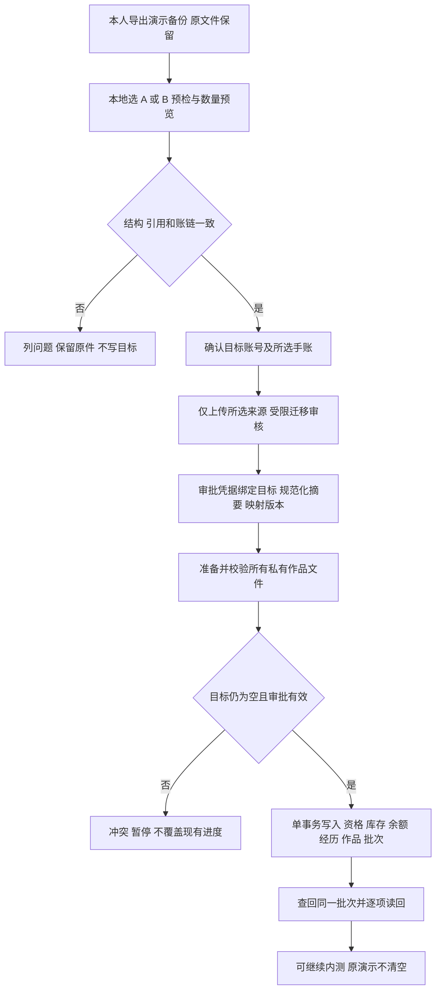

# 演示进度迁移方案

2026-11-08，D07 专项设计。用户明确需要迁移演示进度，要求先单独设计；此前“正式账号完全新建、不导入演示”的建议撤回。**本次只做方案与合成数据的只读预检，没有读取或迁移用户浏览器存档，也没有执行云端写入。**

> 2026-11-12 正式交付边界：用户要求正式前端不含演示内容。本文迁移意图仍保留，但须独立、受限处理，不进入正式游客包；不得默认把演示余额／测试经历变成真实景区数据。具体迁入环境与批准范围仍需评审，尚未执行，见[协作方案](正式前端拆分与后端协作方案.md)。

## 范围和建议结果

建议支持将本人选定的一份演示手账迁入受邀内测账号，保留已有装扮、保存搭配、测试景区次数、首次领奖资格、解锁、经历与固定作品。数据保留 `origin=legacy-demo`、迁移批次和测试／模拟标识，不能变成真实景区到场、真实支付或正式生产奖励。

用户已确认的是“需要迁移、先设计”。下文的单手账选择、目标为空、受限审核和只读订单归档为**实施建议，尚未执行或冻结**。不默认合并 A/B，不默认将演示财产带入未来真实付费环境。

## 已核对的真实存档结构

- [storage.mjs](../design/demo/storage.mjs) 将原型接口映射到 `hxx.demo.v1`；数据对象本身仍为 `version:2`，包含 `current` 和 `accounts`，A/B 不是真实身份。
- [backupArchive](../design/demo/stage/preparation.mjs) 导出整个 JSON，可能包含两位演示游客及作品 base64 PNG；`current` 只表示当时浏览器选择，不能决定迁给谁。
- [store.mjs](../design/store.mjs) 保存拥有、搭配、礼物、领奖、解锁、余额、事件、流水、抽取、订单和作品。经历／流水时间来自本机；活动由 `staff-demo` 及手作点位识别，历史事件没有独立 activityId。
- 备份不含可靠设备 ID、服务端签名、原始素材版本或 epoch，也不含 sessionStorage 中的草稿。格式正确和账面一致不能证明真实性或所有权；这些缺失项不可补造。
- 原型 `hxx.interactive.v2` 不自动混入本次迁移；即使 JSON 结构相似，来源也需明确。原始备份需本人保管，不提交 Git。

## 迁移前后字段处理

| 内容 | 建议迁移结果 | 保持与拒绝条件 |
| --- | --- | --- |
| 账号名／A/B | 只作来源标签，最终 accountId 取可信目标会话 | 不凭 A/B、昵称或上传者传来的 accountId 认领他人数据 |
| 初始选择／伙伴 | 若源已初始化，保留当前保存搭配和拥有 | 目标不能再次初始化覆盖；未初始化的源按新用户处理，不捏造收集记录 |
| 装扮与搭配 | 稳定 assetId 映射，资产全局排重；源 look 单独保留 | 未识别 ID 或失配单独列问题；不可静默删除、替换服装或发齐全套。新动画不支持时需先完成素材适配 |
| 礼物／领奖／解锁 | 与来源事件一起写入对应资格，避免迁入后再领一次 | 礼物不产生到访，不因导入自动穿戴；活动与到店分别保持 |
| 剩余次数 | 仅迁到测试景区；以通过审查的余额建一笔迁入期初流水 | 历史流水另作只读来源，不能与期初再次相加；未知／不一致余额不自动修正 |
| 到访／活动 | 迁为测试经历，保留原日期及来源事件 ID 映射 | 不改成迁移当天，不记为真实定位／店员核验，不重新触发发奖 |
| 抽取记录 | 保存原结果和关联池／资产，纳入来源审计 | 不重抽、不重扣次；重复资产／未知池阻止自动提交 |
| 模拟订单 | 全部只读历史订单；原状态、数量、金额文本保留 | 旧 pending 不生成可支付新订单；旧 paid 不重新到账、不伪装真钱。以后购买另建订单 |
| 作品 PNG 与快照 | 迁移原始 PNG 字节及快照，映射经历引用，保留标题／时间／旧搭配 | 不按新素材重画；解码、字节哈希、私有对象存在性和引用全部通过才提交 |
| 浏览器偏好／草稿 | 不从备份臆造，原设备原应用保留 | 云同步未保存草稿不在本方案；需另确认保留期限／删除支持细节 |

所有未知字段原件保留在受限源包，目标只写明确白名单。版本不支持、图片损坏或引用缺失时给出逐项问题；默认整批不提交。若需要舍弃某项，必须先出新的差异预览并明确确认，不能自动“尽可能导入”。

## 操作与提交状态

迁移页独立于正常领奖和游客操作；先显示来源 A/B、目标脱敏身份、各项数量、剩余次数、订单只读处理及不迁移项，再提供确认。选择文件不上传、不导入。取消和失败保留原件；刷新通过准备 ID 查回，不重新授予。

目标身份先于上传授权。最终真实账号接入前，只能对隔离开发测试账号做合成数据验证，不能把开发会话或任意输入手机号当作已验证所有权。用户本轮允许暂不接短信，不等于允许匿名认领演示财产。

### 所有权、审批与防重

受邀内测建议由受限迁移工具审批：用户指明要迁的手账和目标，管理员核对来源及目标关联，批准具体摘要和映射版本。审核是对测试进度转移的授权，不把可编辑的源 JSON 变成事实证明。目标端不开放“上传任意 JSON 加余额”的游客 API。

- 本地预览仅上传选中的一份手账，不上传另一份；服务重算规范化摘要。哈希用于内容绑定与完整性，不证明归属或真实性。
- `migrationBatch` 保存 targetAccountId、sourceDigest、sourceProfile、mappingVersion、approvalId、状态及结果。唯一约束覆盖 approvalId，以及 targetAccountId＋sourceDigest；同批重试查原结果。
- 摘要无法识别用户稍作修改后的“新文件”。审批必须绑定一次性许可及目标迁移资格；同目标第二份来源禁止自动套用，重新审核。防多账号复制也靠受限授权，不能只查文件哈希。
- 目标锁定后重查是否为空。建议“空”指尚无初始化、业务经历、订单、拥有或作品；只有身份／会话存在。已开始内测的账号需要另设计冲突合并，不能把初始化免费资产自动当作可合并授权。
- 业务记录使用新服务 ID，并保存 `(batchId, sourceKind, legacyId)` 映射；不能只把旧随机 ID 当全局唯一。历史模板／素材版本缺失标 `legacy-unknown`。

### 文件与数据库恢复

作品先传到本批独立私有临时键，服务逐张解码与限额校验，按原字节保存；所有图准备好后，再一次提交业务数据和固定对象引用。失败时目标保持空，临时对象可续传，未被成功批次引用的文件按独立规则清理。不能只迁元数据后提示作品成功。

事务内锁目标账号、复核审批和空状态、迁入数据、写一笔期初余额／完整映射、封存批次结果。传输超时先查询批次，不能重复导入。与普通业务写入使用同一账号锁，阻止迁移与初始化竞态。

提交前可取消；提交后、还没有任何后续业务写入时，可由受限工具按批次及版本检查恢复到原空状态，原图先保留供核对。已有新增消费／抽取／作品后，**不得直接恢复旧库或删除一批关联记录**；须做依赖分析、逐项补偿及再次确认。此回退工具尚未实现，不承诺无条件一键回退。

## 本轮只读验证与后续验收

[migration-preview.mjs](../specs/alpha/migration-preview.mjs) 使用现有解析器和固定配置做只读预检，测试数据由真实演示用例生成，不读取用户存档。默认文本上限 25 MiB 是候选保护值，正式限额按实际作品规模冻结。

已验证：明确选 A/B、原输入不变、账链／余额不一致提示、拥有／资格／解锁来源检查、重复奖励与资产、作品引用／快照、稳定摘要及损坏输入拒绝。**即使全部一致也只返回 `canApply:false`；没有授权、上传、云事务或 PNG 解码。** 当前整备份解析会拒绝另一手账结构损坏的文件，不能自动修复；人工恢复必须保留原件。

后续执行前验收项：

1. 两个账号、两份手账交叉选择，未经批准不可认领；预览与实际写入严格一致，另一手账不上传。
2. 同批多次／并发提交只迁一次；修改内容、换账号、过期审批拒绝；初始化与迁移同时提交仅一方成功。
3. 中途上传失败、最后一图损坏、数据库回滚、提交后丢响应都可恢复且没有半批业务数据。
4. 余额仅一次期初导入，原 paid 不再加次，pending 不能结算，已领取点位再次到访为零奖励。
5. 全池排重、混搭版本、旧作品字节／快照不变；新动画资源缺失不修改原图掩盖问题。
6. 迁移前原备份与浏览器进度不变；读回清单核对后才提示完成；回退分别覆盖无后续写入和有新增数据两种情形。

D07 尚未冻结。下一步先评审这套具体范围与冲突处理，再将批准内容落入 R01-03、R03 的身份／事务／文件实现及 SY/MW 用例；不会以只读预检通过代替实际迁移验收。
