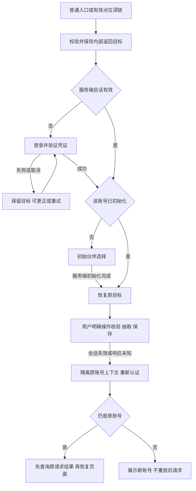

# 账号流程与接入决策

2026-11-08。R01 设计推进稿，基线 `0e6f94e`。目标为真实身份、云端进度，以及 iPhone／Android 系统浏览器和微信内的完整体验。当前已完成渠道比较、状态／页面设计和可执行导航契约；**手机号方向已确认，按用户最新要求暂不接真实短信；G1 未通过**。D04/D05 保持已确认，不重复提问。

## 登录渠道比较与推荐

选择标准依次为：四环境完成同一账号认证、可恢复、组织实际有接入权限、维护和费用可承担；不以页面看起来简单作为选择依据。

| 候选 | 对本项目的价值 | 需验证的输入／代价 | 本轮判断 |
| --- | --- | --- | --- |
| 手机号验证码 | 游客熟悉，手机号验证后可在微信内与浏览器识别同一账号；不必先做两套身份绑定 | 国内短信签名、模板、主体材料和运营商报备；真实送达、限流与费用 | **已确认优先方向，接入暂缓**；主体未定，供应商及资源未落实 |
| 已验证邮箱验证码 | 适合受邀内部／合作方；无需短信运营商签名 | 可发送服务、发信域名及邮箱收信／切应用返回；旅游使用习惯较弱 | 没有短信资源时的内测备选，不能悄悄改成正式游客主渠道 |
| 微信内网页身份＋外部浏览器其他身份 | 微信内进入可少一步输入 | 实际平台权限、回调域名、跨入口绑定和账号冲突；两渠道成本更高 | 不作为第一步唯一登录渠道；“支持微信内网页”不等于必须立即做微信授权登录 |
| 自建密码账号 | 不依赖每次发送验证码 | 密码保护、重置和找回仍需可信通道；增加游客负担 | 暂不优先；开发者手工发通用密码不算正式方案 |

国内短信条件已经查到官方说明：签名用途、资质和生效／运营商报备各有要求，个人认证也不能省略签名主体材料。这里不把审核时长当上线承诺，也不将腾讯云选定为供应商。[腾讯云国内签名管理](https://cloud.tencent.com/document/product/382/37794)

微信的[网页授权](https://developers.weixin.qq.com/doc/offiaccount/OA_Web_Apps/Wechat_webpage_authorization.html)和[JS-SDK](https://developers.weixin.qq.com/doc/offiaccount/OA_Web_Apps/JS-SDK.html)原文在本次查询中读取失败；账号类型、接口权限、域名和实际接入条件仍待管理员与官方文档核对，不引用第三方文章替它们作结论。

用户已确认优先手机号验证码，随后说明主体未定、真实手机号与短信可以暂不接。该方向保留，邮箱不成为默认替代渠道。[接入准备](短信账号接入准备.md)记录后续材料与开发身份边界；当前没有云账号、域名、短信／微信资源，也没有注册、发送或购买。

## 账号状态与入口恢复

账号是服务端生成的稳定 `accountId`；外部身份按 provider＋subject 唯一映射。手机号／邮箱的展示、昵称、头像和本机 A/B 都不能代替该 ID。未来黄晓西接入按可信外部身份映射，不能凭同手机号文案或昵称自动合并已有进度。

登录成功只确定身份，不发装、不打卡、不抽取。初始化需要单独明确确认；扫码进来的新用户初始化后回同一测试点的核验确认页，不强制先领取线上礼物。

## 页面与状态的完整职责

完整布局职责、逐页操作与迁移状态见[账号页面状态稿](账号页面状态稿.md)，覆盖 A01—A05 和 M01—M04；本页保留生命周期摘要。

以下是账号页面的状态稿与交互模型，沿用黔山同行的场景、伙伴与暖色材质，不生成另一套视觉风格。首期按手机号验证码方向细化；真实接入暂缓，不把下表直接改成游客页中的模拟短信服务。

| 页面／状态 | 显示与有效操作 | 成功／写入 | 失败、取消、刷新与返回 |
| --- | --- | --- | --- |
| 登录初态 | 简短相遇文案、伙伴场景、实际认证输入、登录操作、协议说明；无底部游玩导航 | 请求挑战／渠道认证；不创建虚假进度 | 保留合法来源；无来源默认伙伴；加载失败可重试 |
| 发送验证中 | 输入保留、发送反馈、不可重复提交；显示真实发送结果 | 服务器返回 challengeId、冷却／到期信息 | 未确认发送成功不倒计时冒充送达；未知结果查挑战状态 |
| 验证输入 | 脱敏目标、验证码输入、更正账号、按服务时间重发 | 一次性消费凭证，建立／恢复同一账号会话 | 错误、过期、过多尝试分别反馈，不泄露是否已有库存 |
| 外部授权（若选用） | 只在渠道真实可用时出现；明确进入／取消 | 服务端校验 state／回调并换可信身份 | 拒绝授权保留目标，回登录；不无限跳转 |
| 新账号初始化 | 三套初始预览、所有初始免费说明、确认、换账号；无游玩导航 | 原子授予全部初始、保存选中默认 look | 提交超时查原 requestId；失败不显示已创建 |
| 回访恢复 | 有效会话→加载云进度→伙伴或合法深链 | 只读；存储失败不能被当作无进度新账号 | 显示重试，不自动重新初始化 |
| 账号资料 | 脱敏认证身份、会话／支持入口、退出；不放开发复位 | 查询账号数据，不提供任意改余额 | 返回伙伴；无效会话去认证并保存非敏感目标 |
| 会话失效 | 说明需重新进入，保留原账号操作关联及草稿 | 重新认证；同账号先查未知请求结果 | 换成其他账号隔离旧请求，不能自动重试扣次 |
| 退出确认 | 若有草稿说明影响；若有未知写入提供先查询结果 | 撤销本会话、清 UI 缓存；不删除云库存／作品 | 撤销失败明确“未确认退出”；拒绝继续写，重试撤销，不能声称服务器已退出 |
| 恢复账号 | 同一主渠道再次验证；原通道不可用时支持指引 | 必须有可信所有权证据 | 不凭昵称、截图余额或旧浏览器存档恢复别人的账号；支持联系人未定前不放空入口 |
| 绑定冲突（有第二渠道时） | 显示“身份已关联其他账号”，保留当前账号 | 不自动合并；另立可信验证流程 | 不覆盖两个账号进度；首期仅一渠道时不出现无用绑定页 |
| 数据删除申请 | D07 明确渠道、身份核验及处理范围后才出现 | 记录申请与处理状态；删除执行独立确认 | 当前不执行不可逆删除；不能拿清空演示代替注销 |

冷却、验证码有效期、会话期限和日志期限属于待部署方案冻结的服务参数，界面依据服务端时间。任何客户端倒计时都不具有发奖或认证权限。敏感恢复、更换身份与限流的实现应遵循实际认证方案，不能复用本机登录。[OWASP 认证设计](https://cheatsheetseries.owasp.org/cheatsheets/Authentication_Cheat_Sheet.html)

## 返回目标、草稿和跨账号保护

候选内部目标示例：`#checkin?sceneId=demo&pointId=gate&method=qr`。采用路由和参数白名单，不接受任意外站 URL、脚本、重复参数、嵌套 returnTo 或包含结算动作的参数。校验失败回伙伴并说明目标失效。具体点位是否存在仍由目录查询决定，格式正确不等于点位有效。

`returnTo` 仅供导航。待处理业务命令独立保存原 accountId、command、requestId 和状态；登录后只查询原结果，不能无提示重放写操作。保存搭配／制作等编辑页不把整份草稿塞入 URL，而保留按环境＋账号隔离的编辑上下文和合法来源。

D07 已更新：用户要求迁移演示进度，先做独立方案，原“不导入”建议撤回。具体见[迁移方案](演示进度迁移方案.md)：明确选取 A/B、预览目标与差异、受限审批、防重复和原作品保护，尚未执行。未保存草稿仅本设备按账号保护、删除支持与保留周期仍是待收口建议，不能暗写为已确认。

可执行边界见 [navigation.mjs](../specs/alpha/navigation.mjs)：验证新用户深链、非法返回地址、重新认证与换账号隔离；没有认证服务器或自动业务写入。

## 四环境接入检查

| 项目 | 系统浏览器与微信内共同结果 | 实施／验收前还要核对 |
| --- | --- | --- |
| 登录 | 同一可信身份对应同一 accountId；切应用收验证码后仍回原目标 | 实际认证服务、Cookie／回调、四环境版本；不能把微信内 UA 判断当权限 |
| 扫码进入 | 系统相机／微信扫一扫打开同一 HTTPS 点位入口，登录后回核验确认 | 两种外部扫码入口真机验证；应用内相机接口另按必要性评估，不强造系统不支持能力 |
| 应用内核验入口 | 保留输入／粘贴有效测试凭证的可用路径；服务器判断点位和凭证 | 若提供原生扫码按钮，必须实际可用；失败不写到访，不能通过“模拟到场成功”避开主线 |
| 保存图片 | 保存的是实际固定 PNG，离开后可在系统相册／文件中打开并用于微信分享 | 微信内长按／原生分享路径逐机测试；不能只检查 JS Promise 成功 |
| 失效恢复 | 原账号未知操作查回，草稿不串号 | 前后台、刷新、返回、另一设备修改与网络丢包 |

Web Share 只能作为检测支持后的分支，不能假定所有浏览器都有文件分享能力。[MDN Web Share API](https://developer.mozilla.org/en-US/docs/Web/API/Web_Share_API) 不支持原生分享时，仍须在当前环境完成实际图片保存；强制外跳浏览器不是 D05 的通过结果。

## 技术与部署候选

沿用原生前端和 ES modules；后端候选为 Node.js＋PostgreSQL＋私有对象存储，界面只调用用例。理由：现有 JS 可读性和规则能延续，关系约束、事务及跨资产并发易于显式表达；不先换整站框架。官方建议生产采用受支持 LTS；本机验证为 Node 24.12.0，正式发布须选择并锁定当时受支持的安全补丁版本，不能把本机版本直接视为上线版本。[Node 发布政策](https://nodejs.org/en/about/previous-releases)

| 方案 | 收益 | 代价／适用条件 |
| --- | --- | --- |
| 复用组织已有云环境 | 身份权限、域名、运维责任可沿用 | 本次用户确认暂无，当前不可执行；今后新增可用资源再核查 |
| 独立服务＋关系数据库＋对象存储 | 规则、事务、迁移与私有文件边界清楚；供应商适配可独立替换 | 要有人维护服务、备份、监控及费用；域名 HTTPS 和访问条件需落实 |
| 一体化托管后端 | 初始部署和身份能力可能减少维护量 | 仍需验证服务端事务／函数、权限、国内访问和退出迁移；不能默认浏览器直接写库存 |

暂不报套餐价格或已购配置。资源确认后按月测算：计算／数据库保底＋图片与备份 GB·月＋下行 GB＋验证码发送量＋域名／证书／监控＋制作工具授权。短信重发、保存图片量、备份保留和恢复目标都计入，不能用零用户免费额度冒充运营成本。

当前真实接入按用户要求暂缓；迁移方案已独立形成。模型、接口和制作规格继续推进，G1 仍需部署／数据政策及可验证环境明确；开发测试不能替代真实身份验收，不要求用户对每份文档重复口头验收。
